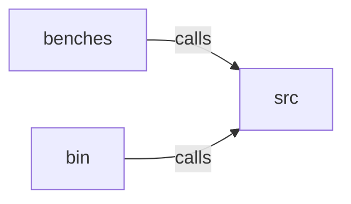

_Generated by CodeAtlas._

## Details

Owns 0 symbols across 1 file(s).

### benches

Owns 16 symbols across 1 file(s).

**Related Classes/Methods:** _None_

**Source Files:**

- `core/benches/load_test.rs`
  - `core.benches.load_test.LoadTestConfig`
  - `core.benches.load_test.LoadTestConfig.burst_test`
  - `core.benches.load_test.LoadTestConfig.heavy_load`
  - `core.benches.load_test.LoadTestConfig.light_load`
  - `core.benches.load_test.LoadTestConfig.medium_load`
  - `core.benches.load_test.LoadTestMetrics`
  - `core.benches.load_test.LoadTestMetrics.fmt`
  - `core.benches.load_test.LoadTestRunner`
  - `core.benches.load_test.LoadTestRunner.calculate_metrics`
  - `core.benches.load_test.LoadTestRunner.new`
  - `core.benches.load_test.LoadTestRunner.run`
  - `core.benches.load_test.LoadTestRunner.simulate_activation`
  - `core.benches.load_test.tests.test_burst_load`
  - `core.benches.load_test.tests.test_heavy_load`
  - `core.benches.load_test.tests.test_light_load`
  - `core.benches.load_test.tests.test_medium_load`

### bin

Owns 8 symbols across 1 file(s).

**Related Classes/Methods:** _None_

**Source Files:**

- `core/bin/pyreverseetl_dashboard.rs`
  - `core.bin.pyreverseetl_dashboard.DashboardArgs`
  - `core.bin.pyreverseetl_dashboard.DashboardArgs.default`
  - `core.bin.pyreverseetl_dashboard.format_float`
  - `core.bin.pyreverseetl_dashboard.format_number`
  - `core.bin.pyreverseetl_dashboard.main`
  - `core.bin.pyreverseetl_dashboard.parse_args`
  - `core.bin.pyreverseetl_dashboard.print_help`
  - `core.bin.pyreverseetl_dashboard.render_dashboard`

### src

Owns 224 symbols across 13 file(s).

**Related Classes/Methods:** _None_

**Source Files:**

- `core/src/activation.rs`
  - `core.src.activation.Activation`
  - `core.src.activation.Activation.add_destination`
  - `core.src.activation.Activation.add_validation_gate`
  - `core.src.activation.Activation.get_policy`
  - `core.src.activation.Activation.increment_version`
  - `core.src.activation.Activation.new`
  - `core.src.activation.Activation.requires_validation`
  - `core.src.activation.Activation.set_enabled`
  - `core.src.activation.Activation.set_policy`
  - `core.src.activation.Activation.update_timestamp`
  - `core.src.activation.Activation.with_description`
  - `core.src.activation.Activation.with_validation_gates`
  - `core.src.activation.tests.test_activation_builder`
  - `core.src.activation.tests.test_activation_complete_workflow`
  - `core.src.activation.tests.test_activation_creation`
  - `core.src.activation.tests.test_activation_disabled`
  - `core.src.activation.tests.test_activation_policies`
  - `core.src.activation.tests.test_activation_statguardian_integration`
  - `core.src.activation.tests.test_activation_version_increment`
  - `core.src.activation.tests.test_activation_with_validation_gates`
- `core/src/destination.rs`
  - `core.src.destination.Destination`
  - `core.src.destination.Destination.get_config`
  - `core.src.destination.Destination.increment_version`
  - `core.src.destination.Destination.new`
  - `core.src.destination.Destination.set_config`
  - `core.src.destination.Destination.set_enabled`
  - `core.src.destination.Destination.update_timestamp`
  - `core.src.destination.DestinationType`
  - `core.src.destination.DestinationType.as_str`
  - `core.src.destination.tests.test_destination_all_types`
  - `core.src.destination.tests.test_destination_complex_config`
  - `core.src.destination.tests.test_destination_config`
  - `core.src.destination.tests.test_destination_creation`
  - `core.src.destination.tests.test_destination_disabled`
  - `core.src.destination.tests.test_destination_get_config`
  - `core.src.destination.tests.test_destination_type_str`
  - `core.src.destination.tests.test_destination_version_increment`
- `core/src/entity.rs`
  - `core.src.entity.Audience`
  - `core.src.entity.Entity`
  - `core.src.entity.Entity.add_attribute`
  - `core.src.entity.Entity.add_trait`
  - `core.src.entity.Entity.attribute_count`
  - `core.src.entity.Entity.get_attribute`
  - `core.src.entity.Entity.get_trait`
  - `core.src.entity.Entity.new`
  - `core.src.entity.Entity.trait_count`
  - `core.src.entity.Entity.update_timestamp`
  - `core.src.entity.EntityType`
  - `core.src.entity.EntityType.as_str`
  - `core.src.entity.Metric`
  - `core.src.entity.Trait`
  - `core.src.entity.tests.test_entity_all_types`
  - `core.src.entity.tests.test_entity_attributes`
  - `core.src.entity.tests.test_entity_complex_structure`
  - `core.src.entity.tests.test_entity_count_traits_and_attributes`
  - `core.src.entity.tests.test_entity_creation`
  - `core.src.entity.tests.test_entity_get_attribute`
  - `core.src.entity.tests.test_entity_get_trait`
  - `core.src.entity.tests.test_entity_timestamp_update`
  - `core.src.entity.tests.test_entity_traits`
- `core/src/error.rs`
  - `core.src.error.Error`
- `core/src/executor.rs`
  - `core.src.executor.DestinationSpec`
  - `core.src.executor.ExecuteOptions`
  - `core.src.executor.ExecutionResult`
  - `core.src.executor.SourceSpec`
  - `core.src.executor.batch_shape_entity`
  - `core.src.executor.describe_schema_change`
  - `core.src.executor.destination_schema_key`
  - `core.src.executor.entity_to_record`
  - `core.src.executor.execute_sync`
  - `core.src.executor.execute_with_records`
  - `core.src.executor.read_from_source`
  - `core.src.executor.record_to_entity`
  - `core.src.executor.tests.dry_run_never_calls_the_destination_and_previews_the_real_payload`
  - `core.src.executor.tests.dry_run_preview_reflects_compliance_masking`
  - `core.src.executor.tests.empty_batch_does_not_falsely_report_every_field_removed`
  - `core.src.executor.tests.execute_with_records_honestly_reports_unimplemented_encryption_as_a_violation`
  - `core.src.executor.tests.execute_with_records_masks_pii_before_it_ever_leaves_the_process`
  - `core.src.executor.tests.execute_with_records_writes_real_http_requests_and_records_real_lineage`
  - `core.src.executor.tests.idempotency_disabled_by_default_resends_every_record_every_run`
  - `core.src.executor.tests.idempotency_still_resends_a_record_whose_content_genuinely_changed`
  - `core.src.executor.tests.idempotent_rerun_skips_already_synced_records_and_makes_no_new_requests`
  - `core.src.executor.tests.sample_records`
  - `core.src.executor.tests.schema_drift_is_detected_and_persisted_across_separate_runs`
  - `core.src.executor.tests.source_node`
  - `core.src.executor.write_to_destination`
  - `core.src.executor.write_via_adapter`
- `core/src/idempotency.rs`
  - `core.src.idempotency.IdempotencyLedger`
  - `core.src.idempotency.IdempotencyLedger.already_synced`
  - `core.src.idempotency.IdempotencyLedger.from_connection`
  - `core.src.idempotency.IdempotencyLedger.in_memory`
  - `core.src.idempotency.IdempotencyLedger.mark_synced`
  - `core.src.idempotency.IdempotencyLedger.open`
  - `core.src.idempotency.canonicalize`
  - `core.src.idempotency.content_hash`
  - `core.src.idempotency.tests.changed_content_is_not_already_synced_even_with_same_id`
  - `core.src.idempotency.tests.content_hash_changes_when_content_changes`
  - `core.src.idempotency.tests.content_hash_is_stable_regardless_of_key_order`
  - `core.src.idempotency.tests.mark_synced_twice_updates_the_hash`
  - `core.src.idempotency.tests.marked_record_is_already_synced_with_same_hash`
  - `core.src.idempotency.tests.persists_across_separate_connections_to_the_same_file`
  - `core.src.idempotency.tests.same_record_id_in_different_destinations_does_not_collide`
  - `core.src.idempotency.tests.unseen_record_is_not_already_synced`
- `core/src/lineage.rs`
  - `core.src.lineage.LineageEdge`
  - `core.src.lineage.LineageEdge.duration_ms`
  - `core.src.lineage.LineageGraph`
  - `core.src.lineage.LineageGraph.downstream_of`
  - `core.src.lineage.LineageGraph.edges_for_run`
  - `core.src.lineage.LineageGraph.new`
  - `core.src.lineage.LineageGraph.record_edge`
  - `core.src.lineage.LineageGraph.to_dot`
  - `core.src.lineage.LineageGraph.to_json`
  - `core.src.lineage.LineageGraph.total_records_received`
  - `core.src.lineage.LineageGraph.upsert_node`
  - `core.src.lineage.LineageGraph.upstream_of`
  - `core.src.lineage.LineageNode`
  - `core.src.lineage.LineageNode.new`
  - `core.src.lineage.LineageNodeKind`
  - `core.src.lineage.LineageStore`
  - `core.src.lineage.LineageStore.edges_for_run`
  - `core.src.lineage.LineageStore.new`
  - `core.src.lineage.LineageStore.record_sync`
  - `core.src.lineage.LineageStore.snapshot`
  - `core.src.lineage.LineageStore.to_dot`
  - `core.src.lineage.LineageStore.to_json`
  - `core.src.lineage.tests.destination`
  - `core.src.lineage.tests.dot_export_contains_nodes_and_edges`
  - `core.src.lineage.tests.edges_for_run_filters_by_run_id`
  - `core.src.lineage.tests.json_export_round_trips`
  - `core.src.lineage.tests.lineage_store_clones_share_the_same_underlying_graph`
  - `core.src.lineage.tests.lineage_store_is_shareable_and_accumulates_across_calls`
  - `core.src.lineage.tests.record_edge_captures_real_counts_and_timestamps`
  - `core.src.lineage.tests.source`
  - `core.src.lineage.tests.total_records_received_sums_all_inbound_edges`
  - `core.src.lineage.tests.upsert_node_is_idempotent`
  - `core.src.lineage.tests.upstream_and_downstream_queries_are_real_graph_traversal`
- `core/src/statguardian.rs`
  - `core.src.statguardian.StatGuardianConfig`
  - `core.src.statguardian.ValidationGate`
  - `core.src.statguardian.ValidationGate.allow_stale_for`
  - `core.src.statguardian.ValidationGate.block_on_failure`
  - `core.src.statguardian.ValidationGate.new`
  - `core.src.statguardian.ValidationResult`
  - `core.src.statguardian.ValidationResult.is_usable`
  - `core.src.statguardian.ValidationResult.is_valid`
  - `core.src.statguardian.ValidationStatus`
  - `core.src.statguardian.tests.test_validation_gate_builder`
  - `core.src.statguardian.tests.test_validation_gate_creation`
  - `core.src.statguardian.tests.test_validation_result_is_valid`
- `core/src/streampdf.rs`
  - `core.src.streampdf.ExtractedData`
  - `core.src.streampdf.ExtractionMode`
  - `core.src.streampdf.StreamPDFConfig`
  - `core.src.streampdf.StreamPDFSource`
  - `core.src.streampdf.StreamPDFSource.new`
  - `core.src.streampdf.StreamPDFSource.token_efficient`
  - `core.src.streampdf.StreamPDFSource.with_max_tokens`
  - `core.src.streampdf.StreamPDFSource.with_min_confidence`
  - `core.src.streampdf.tests.test_streampdf_config_modes`
  - `core.src.streampdf.tests.test_streampdf_source_creation`
  - `core.src.streampdf.tests.test_streampdf_token_efficient`
- `core/src/streamxl.rs`
  - `core.src.streamxl.StreamXLAccessMethod`
  - `core.src.streamxl.StreamXLConfig`
  - `core.src.streamxl.StreamXLSource`
  - `core.src.streamxl.StreamXLSource.add_column_mapping`
  - `core.src.streamxl.StreamXLSource.new`
  - `core.src.streamxl.StreamXLSource.with_query`
  - `core.src.streamxl.tests.test_streamxl_source_creation`
  - `core.src.streamxl.tests.test_streamxl_source_with_mapping`
- `core/src/sync.rs`
  - `core.src.sync.SyncEngine`
  - `core.src.sync.SyncEngine.new`
  - `core.src.sync.SyncRecord`
  - `core.src.sync.SyncRecord.is_completed`
  - `core.src.sync.SyncRecord.mark_failed`
  - `core.src.sync.SyncRecord.mark_success`
  - `core.src.sync.SyncRecord.new`
  - `core.src.sync.SyncRecord.payload_size`
  - `core.src.sync.SyncRun`
  - `core.src.sync.SyncRun.is_completed`
  - `core.src.sync.SyncRun.is_successful`
  - `core.src.sync.SyncRun.mark_cancelled`
  - `core.src.sync.SyncRun.mark_failed`
  - `core.src.sync.SyncRun.mark_running`
  - `core.src.sync.SyncRun.mark_success`
  - `core.src.sync.SyncRun.new`
  - `core.src.sync.SyncRun.record_failed`
  - `core.src.sync.SyncRun.record_processed`
  - `core.src.sync.SyncRun.success_rate`
  - `core.src.sync.SyncRun.total_records`
  - `core.src.sync.SyncStatus`
  - `core.src.sync.SyncStatus.fmt`
  - `core.src.sync.tests.test_sync_engine_creation`
  - `core.src.sync.tests.test_sync_record_creation`
  - `core.src.sync.tests.test_sync_record_lifecycle`
  - `core.src.sync.tests.test_sync_record_payload_size`
  - `core.src.sync.tests.test_sync_run_cancellation`
  - `core.src.sync.tests.test_sync_run_failure`
  - `core.src.sync.tests.test_sync_run_lifecycle`
  - `core.src.sync.tests.test_sync_run_metrics`
  - `core.src.sync.tests.test_sync_run_with_zero_records`
- `core/src/workflow.rs`
  - `core.src.workflow.EventStreamConfig`
  - `core.src.workflow.FieldMapping`
  - `core.src.workflow.RateLimit`
  - `core.src.workflow.Schedule`
  - `core.src.workflow.SourceType`
  - `core.src.workflow.SourceType.default`
  - `core.src.workflow.SyncMode`
  - `core.src.workflow.Workflow`
  - `core.src.workflow.Workflow.add_mapping`
  - `core.src.workflow.Workflow.increment_version`
  - `core.src.workflow.Workflow.new`
  - `core.src.workflow.Workflow.set_enabled`
  - `core.src.workflow.Workflow.set_event_stream_config`
  - `core.src.workflow.Workflow.set_rate_limit`
  - `core.src.workflow.Workflow.set_schedule`
  - `core.src.workflow.Workflow.set_sync_mode`
  - `core.src.workflow.Workflow.update_timestamp`
  - `core.src.workflow.Workflow.with_description`
  - `core.src.workflow.tests.test_workflow_builder`
  - `core.src.workflow.tests.test_workflow_creation`
  - `core.src.workflow.tests.test_workflow_disabled`
  - `core.src.workflow.tests.test_workflow_event_stream_config`
  - `core.src.workflow.tests.test_workflow_rate_limit`
  - `core.src.workflow.tests.test_workflow_sync_modes`
  - `core.src.workflow.tests.test_workflow_version_increment`
  - `core.src.workflow.tests.test_workflow_with_all_features`
