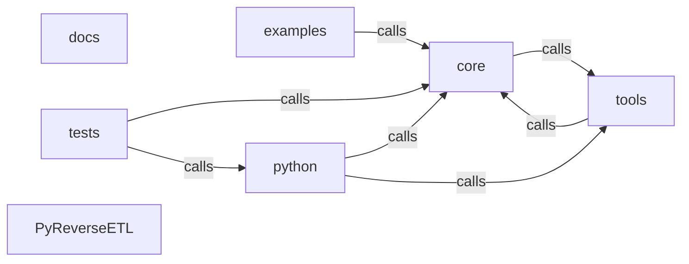

_Generated by CodeAtlas._

## Details

Architecture map of PyReverseETL.

### core

Owns 0 symbols across 1 file(s).

**Related Classes/Methods:** _None_

### docs

Owns 0 symbols across 50 file(s).

**Related Classes/Methods:** _None_

### examples

Owns 3 symbols across 9 file(s).

**Related Classes/Methods:** _None_

**Source Files:**

- `examples/performance_baseline.rs`
  - `examples.performance_baseline.main`
  - `examples.performance_baseline.run_load_test`
- `examples/with_dashboard.rs`
  - `examples.with_dashboard.main`

### python

Owns 0 symbols across 1 file(s).

**Related Classes/Methods:** _None_

### tests

Owns 54 symbols across 6 file(s).

**Related Classes/Methods:** _None_

**Source Files:**

- `tests/realistic_reverse_etl_benchmark.py`
  - `tests.realistic_reverse_etl_benchmark.generate_test_data`
  - `tests.realistic_reverse_etl_benchmark.main`
  - `tests.realistic_reverse_etl_benchmark.setup_database`
  - `tests.realistic_reverse_etl_benchmark.test_with_transformation`
  - `tests.realistic_reverse_etl_benchmark.test_with_transformation.normalize_customer`
  - `tests.realistic_reverse_etl_benchmark.test_without_transformation`
- `tests/reverse_etl_benchmark.py`
  - `tests.reverse_etl_benchmark.generate_test_data`
  - `tests.reverse_etl_benchmark.main`
  - `tests.reverse_etl_benchmark.test_with_transformation`
  - `tests.reverse_etl_benchmark.test_with_transformation.normalize_customer`
  - `tests.reverse_etl_benchmark.test_without_transformation`
- `tests/test_codeatlas_adapter.py`
  - `tests.test_codeatlas_adapter._run`
  - `tests.test_codeatlas_adapter.test_check_reports_the_embedded_engine_available`
  - `tests.test_codeatlas_adapter.test_diagnose_summarises_the_architecture_map`
  - `tests.test_codeatlas_adapter.test_explain_reports_an_unknown_node_as_an_error`
  - `tests.test_codeatlas_adapter.test_god_nodes_are_ranked_by_degree`
- `tests/test_python_bindings.py`
  - `tests.test_python_bindings.test_cli_execute_parses_dry_run_and_store_path_flags`
  - `tests.test_python_bindings.test_cli_execute_parses_dry_run_and_store_path_flags.fake_execute_activation`
  - `tests.test_python_bindings.test_pyreverseetl_import`
  - `tests.test_python_bindings.test_pyreverseetl_version`
  - `tests.test_python_bindings.test_run_sync_accepts_dry_run_and_store_path_kwargs`
- `tests/test_real_sync_docker.py`
  - `tests.test_real_sync_docker._create_mysql_table`
  - `tests.test_real_sync_docker._drop_mysql_table`
  - `tests.test_real_sync_docker._mysql_config`
  - `tests.test_real_sync_docker._pg_config`
  - `tests.test_real_sync_docker._port_open`
  - `tests.test_real_sync_docker._query_mysql`
  - `tests.test_real_sync_docker._seed_postgres`
  - `tests.test_real_sync_docker.test_cli_execute_activation_drives_the_real_engine`
  - `tests.test_real_sync_docker.test_cli_execute_activation_drives_the_real_engine.run_cli`
  - `tests.test_real_sync_docker.test_cli_version_reports_the_real_installed_version`
  - `tests.test_real_sync_docker.test_lineage_reflects_real_sync_runs`
  - `tests.test_real_sync_docker.test_run_sync_applies_real_compliance_masking`
  - `tests.test_real_sync_docker.test_run_sync_postgres_to_mysql_moves_real_rows`
- `tests/test_server.py`
  - `tests.test_server.client`
  - `tests.test_server.server`
  - `tests.test_server.test_create_activation_requires_existing_workflow`
  - `tests.test_server.test_create_and_list_activations`
  - `tests.test_server.test_create_and_list_workflows`
  - `tests.test_server.test_execute_unknown_activation_returns_error`
  - `tests.test_server.test_get_lineage_json_and_dot`
  - `tests.test_server.test_get_metrics_empty`
  - `tests.test_server.test_get_run_status_unknown`
  - `tests.test_server.test_health_check`
  - `tests.test_server.test_route_create_activation_requires_id`
  - `tests.test_server.test_route_create_and_fetch_workflow`
  - `tests.test_server.test_route_create_workflow_requires_id`
  - `tests.test_server.test_route_execute_unknown_activation_is_error_payload`
  - `tests.test_server.test_route_health`
  - `tests.test_server.test_route_lineage_dot_sets_graphviz_content_type`
  - `tests.test_server.test_route_lineage_json`
  - `tests.test_server.test_route_list_workflows_empty`
  - `tests.test_server.test_route_metrics`
  - `tests.test_server.test_server_defaults_to_loopback`

### tools

Owns 0 symbols across 0 file(s).

**Related Classes/Methods:** _None_

### PyReverseETL

Owns 0 symbols across 16 file(s).

**Related Classes/Methods:** _None_
