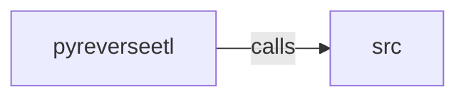

_Generated by CodeAtlas._

## Details

Owns 0 symbols across 1 file(s).

### pyreverseetl

Owns 37 symbols across 3 file(s).

**Related Classes/Methods:** _None_

**Source Files:**

- `python/pyreverseetl/cli.py`
  - `python.pyreverseetl.cli.CLIInterface`
  - `python.pyreverseetl.cli.CLIInterface.__init__`
  - `python.pyreverseetl.cli.CLIInterface._load_state`
  - `python.pyreverseetl.cli.CLIInterface._save_state`
  - `python.pyreverseetl.cli.CLIInterface.create_activation`
  - `python.pyreverseetl.cli.CLIInterface.create_workflow`
  - `python.pyreverseetl.cli.CLIInterface.execute_activation`
  - `python.pyreverseetl.cli.CLIInterface.get_lineage`
  - `python.pyreverseetl.cli.CLIInterface.get_metrics`
  - `python.pyreverseetl.cli.CLIInterface.get_run_status`
  - `python.pyreverseetl.cli.CLIInterface.list_activations`
  - `python.pyreverseetl.cli.CLIInterface.list_workflows`
  - `python.pyreverseetl.cli._parse_config_arg`
  - `python.pyreverseetl.cli.main`
  - `python.pyreverseetl.cli.print_help`
- `python/pyreverseetl/server.py`
  - `python.pyreverseetl.server.PyReverseETLServer`
  - `python.pyreverseetl.server.PyReverseETLServer.__init__`
  - `python.pyreverseetl.server.PyReverseETLServer.create_activation`
  - `python.pyreverseetl.server.PyReverseETLServer.create_workflow`
  - `python.pyreverseetl.server.PyReverseETLServer.execute_activation`
  - `python.pyreverseetl.server.PyReverseETLServer.get_lineage`
  - `python.pyreverseetl.server.PyReverseETLServer.get_metrics`
  - `python.pyreverseetl.server.PyReverseETLServer.get_run_status`
  - `python.pyreverseetl.server.PyReverseETLServer.health_check`
  - `python.pyreverseetl.server.PyReverseETLServer.list_activations`
  - `python.pyreverseetl.server.PyReverseETLServer.list_workflows`
  - `python.pyreverseetl.server.create_flask_app`
  - `python.pyreverseetl.server.create_flask_app.create_activation`
  - `python.pyreverseetl.server.create_flask_app.create_workflow`
  - `python.pyreverseetl.server.create_flask_app.execute_activation`
  - `python.pyreverseetl.server.create_flask_app.get_status`
  - `python.pyreverseetl.server.create_flask_app.health`
  - `python.pyreverseetl.server.create_flask_app.lineage`
  - `python.pyreverseetl.server.create_flask_app.list_activations`
  - `python.pyreverseetl.server.create_flask_app.list_workflows`
  - `python.pyreverseetl.server.create_flask_app.metrics`
  - `python.pyreverseetl.server.run_server`

### src

Owns 47 symbols across 1 file(s).

**Related Classes/Methods:** _None_

**Source Files:**

- `python/src/lib.rs`
  - `python.src.lib.PyActivation`
  - `python.src.lib.PyActivation.add_destination`
  - `python.src.lib.PyActivation.id`
  - `python.src.lib.PyActivation.name`
  - `python.src.lib.PyActivation.new`
  - `python.src.lib.PyActivation.set_enabled`
  - `python.src.lib.PyDestination`
  - `python.src.lib.PyDestination.id`
  - `python.src.lib.PyDestination.name`
  - `python.src.lib.PyDestination.new`
  - `python.src.lib.PyDestination.set_enabled`
  - `python.src.lib.PyEntity`
  - `python.src.lib.PyEntity.add_attribute`
  - `python.src.lib.PyEntity.add_trait`
  - `python.src.lib.PyEntity.id`
  - `python.src.lib.PyEntity.new`
  - `python.src.lib.PySyncResult`
  - `python.src.lib.PySyncRun`
  - `python.src.lib.PySyncRun.id`
  - `python.src.lib.PySyncRun.mark_running`
  - `python.src.lib.PySyncRun.mark_success`
  - `python.src.lib.PySyncRun.new`
  - `python.src.lib.PySyncRun.record_processed`
  - `python.src.lib.PySyncRun.status`
  - `python.src.lib.PyWorkflow`
  - `python.src.lib.PyWorkflow.add_mapping`
  - `python.src.lib.PyWorkflow.id`
  - `python.src.lib.PyWorkflow.name`
  - `python.src.lib.PyWorkflow.new`
  - `python.src.lib.PyWorkflow.set_enabled`
  - `python.src.lib.PyWorkflow.with_description`
  - `python.src.lib._core`
  - `python.src.lib.build_auth`
  - `python.src.lib.build_compliance_rules`
  - `python.src.lib.build_destination_spec`
  - `python.src.lib.build_object_storage_config`
  - `python.src.lib.build_source_spec`
  - `python.src.lib.get_str`
  - `python.src.lib.get_str_opt`
  - `python.src.lib.get_u16`
  - `python.src.lib.json_object_to_map`
  - `python.src.lib.lineage_dot`
  - `python.src.lib.lineage_json`
  - `python.src.lib.lineage_store`
  - `python.src.lib.parse_json`
  - `python.src.lib.py_err`
  - `python.src.lib.run_sync`
