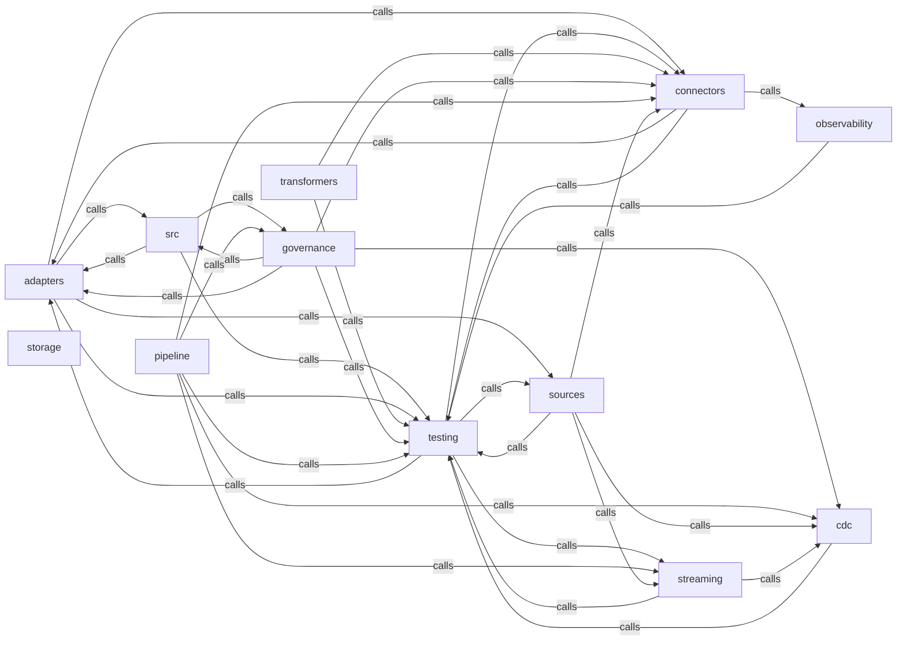

_Generated by CodeAtlas._

## Details

Owns 224 symbols across 13 file(s).

### adapters

Owns 229 symbols across 12 file(s).

**Related Classes/Methods:** _None_

**Source Files:**

- `core/src/adapters/alert_compat.rs`
  - `core.src.adapters.alert_compat.AlertBuilder`
  - `core.src.adapters.alert_compat.AlertBuilder.build`
  - `core.src.adapters.alert_compat.AlertBuilder.category`
  - `core.src.adapters.alert_compat.AlertBuilder.context`
  - `core.src.adapters.alert_compat.AlertBuilder.new`
  - `core.src.adapters.alert_compat.AlertBuilder.resource`
  - `core.src.adapters.alert_compat.AlertBuilder.severity`
  - `core.src.adapters.alert_compat.AlertBuilder.tag`
  - `core.src.adapters.alert_compat.AlertCategory`
  - `core.src.adapters.alert_compat.AlertCategory.as_str`
  - `core.src.adapters.alert_compat.AlertMessage`
  - `core.src.adapters.alert_compat.AlertSeverity`
  - `core.src.adapters.alert_compat.AlertSeverity.as_str`
  - `core.src.adapters.alert_compat.RateLimitAlert`
  - `core.src.adapters.alert_compat.RateLimitAlert.to_alert_message`
  - `core.src.adapters.alert_compat.SchemaDriftAlert`
  - `core.src.adapters.alert_compat.SchemaDriftAlert.to_alert_message`
  - `core.src.adapters.alert_compat.TypeMismatchAlert`
  - `core.src.adapters.alert_compat.TypeMismatchAlert.to_alert_message`
  - `core.src.adapters.alert_compat.tests.test_alert_builder`
  - `core.src.adapters.alert_compat.tests.test_alert_severity_ordering`
  - `core.src.adapters.alert_compat.tests.test_rate_limit_alert_to_message`
  - `core.src.adapters.alert_compat.tests.test_schema_drift_alert_to_message`
  - `core.src.adapters.alert_compat.tests.test_type_mismatch_alert_to_message`
- `core/src/adapters/error.rs`
  - `core.src.adapters.error.AdapterError`
  - `core.src.adapters.error.AdapterError.fmt`
  - `core.src.adapters.error.Error.from`
  - `core.src.adapters.error.tests.test_authentication_failed_error`
  - `core.src.adapters.error.tests.test_batch_size_exceeded_error`
  - `core.src.adapters.error.tests.test_rate_limit_error`
  - `core.src.adapters.error.tests.test_unsupported_destination_error`
- `core/src/adapters/http_client.rs`
  - `core.src.adapters.http_client.HttpClient`
  - `core.src.adapters.http_client.HttpClient.add_auth_header`
  - `core.src.adapters.http_client.HttpClient.base_url`
  - `core.src.adapters.http_client.HttpClient.delete`
  - `core.src.adapters.http_client.HttpClient.get`
  - `core.src.adapters.http_client.HttpClient.handle_response`
  - `core.src.adapters.http_client.HttpClient.new`
  - `core.src.adapters.http_client.HttpClient.patch`
  - `core.src.adapters.http_client.HttpClient.post`
  - `core.src.adapters.http_client.HttpClient.timeout`
  - `core.src.adapters.http_client.HttpClient.with_retry_policy`
  - `core.src.adapters.http_client.tests.test_auth_header_api_key`
  - `core.src.adapters.http_client.tests.test_auth_header_bearer`
  - `core.src.adapters.http_client.tests.test_http_client_creation`
  - `core.src.adapters.http_client.tests.test_http_client_timeout`
  - `core.src.adapters.http_client.tests.test_http_client_with_api_key`
  - `core.src.adapters.http_client.tests.test_retry_policy_integration`
- `core/src/adapters/hubspot.rs`
  - `core.src.adapters.hubspot.HubSpotAdapter`
  - `core.src.adapters.hubspot.HubSpotAdapter.authenticate`
  - `core.src.adapters.hubspot.HubSpotAdapter.batch_upsert`
  - `core.src.adapters.hubspot.HubSpotAdapter.delete`
  - `core.src.adapters.hubspot.HubSpotAdapter.get_schema`
  - `core.src.adapters.hubspot.HubSpotAdapter.name`
  - `core.src.adapters.hubspot.HubSpotAdapter.new`
  - `core.src.adapters.hubspot.HubSpotAdapter.properties`
  - `core.src.adapters.hubspot.HubSpotAdapter.upsert`
  - `core.src.adapters.hubspot.tests.api_key`
  - `core.src.adapters.hubspot.tests.config_with_base`
  - `core.src.adapters.hubspot.tests.delete_hits_the_real_object_delete_endpoint`
  - `core.src.adapters.hubspot.tests.get_schema_parses_a_real_properties_response_shape`
  - `core.src.adapters.hubspot.tests.test_hubspot_batch_limit`
  - `core.src.adapters.hubspot.tests.test_hubspot_creation`
  - `core.src.adapters.hubspot.tests.test_hubspot_missing_api_key`
  - `core.src.adapters.hubspot.tests.upsert_does_not_retry_a_non_retryable_auth_failure`
  - `core.src.adapters.hubspot.tests.upsert_retries_past_transient_rate_limit_and_succeeds`
  - `core.src.adapters.hubspot.tests.upsert_with_email_patches_the_real_upsert_by_id_property_endpoint`
  - `core.src.adapters.hubspot.tests.upsert_without_email_falls_back_to_real_create_endpoint`
- `core/src/adapters/mapping.rs`
  - `core.src.adapters.mapping.MappingConfig`
  - `core.src.adapters.mapping.MappingConfig.from_file`
  - `core.src.adapters.mapping.MappingConfig.from_yaml`
  - `core.src.adapters.mapping.MappingConfig.to_field_mappings`
  - `core.src.adapters.mapping.MappingConfig.to_yaml`
  - `core.src.adapters.mapping.MappingEntry`
  - `core.src.adapters.mapping.TransformConfig`
  - `core.src.adapters.mapping.TransformConfig.to_transformation`
  - `core.src.adapters.mapping.tests.test_mapping_to_field_mappings`
  - `core.src.adapters.mapping.tests.test_parse_hubspot_yaml`
  - `core.src.adapters.mapping.tests.test_parse_marketo_yaml`
  - `core.src.adapters.mapping.tests.test_parse_salesforce_yaml`
  - `core.src.adapters.mapping.tests.test_transformation_identity`
  - `core.src.adapters.mapping.tests.test_transformation_round_decimals`
  - `core.src.adapters.mapping.tests.test_yaml_roundtrip`
- `core/src/adapters/marketo.rs`
  - `core.src.adapters.marketo.MarketoAdapter`
  - `core.src.adapters.marketo.MarketoAdapter.authenticate`
  - `core.src.adapters.marketo.MarketoAdapter.batch_upsert`
  - `core.src.adapters.marketo.MarketoAdapter.delete`
  - `core.src.adapters.marketo.MarketoAdapter.exchange_token`
  - `core.src.adapters.marketo.MarketoAdapter.get_schema`
  - `core.src.adapters.marketo.MarketoAdapter.lead_fields`
  - `core.src.adapters.marketo.MarketoAdapter.name`
  - `core.src.adapters.marketo.MarketoAdapter.new`
  - `core.src.adapters.marketo.MarketoAdapter.token`
  - `core.src.adapters.marketo.MarketoAdapter.upsert`
  - `core.src.adapters.marketo.tests.authenticate_performs_a_real_identity_token_exchange`
  - `core.src.adapters.marketo.tests.config_for`
  - `core.src.adapters.marketo.tests.delete_posts_the_real_leads_delete_endpoint`
  - `core.src.adapters.marketo.tests.get_schema_parses_a_real_describe_response_shape`
  - `core.src.adapters.marketo.tests.oauth`
  - `core.src.adapters.marketo.tests.test_marketo_batch_limit`
  - `core.src.adapters.marketo.tests.test_marketo_creation`
  - `core.src.adapters.marketo.tests.upsert_posts_the_real_createorupdate_bulk_lead_shape`
  - `core.src.adapters.marketo.tests.upsert_reports_failure_when_marketo_rejects_the_lead`
  - `core.src.adapters.marketo.tests.upsert_retries_past_transient_rate_limit_and_succeeds`
- `core/src/adapters/mod.rs`
  - `core.src.adapters.mod.AdapterFactory`
  - `core.src.adapters.mod.AdapterFactory.create_adapter`
  - `core.src.adapters.mod.AuthMethod`
  - `core.src.adapters.mod.BatchResult`
  - `core.src.adapters.mod.DestinationAdapter`
  - `core.src.adapters.mod.DestinationSchema`
  - `core.src.adapters.mod.FieldMapping`
  - `core.src.adapters.mod.FieldType`
  - `core.src.adapters.mod.OperationResult`
  - `core.src.adapters.mod.Transformation`
  - `core.src.adapters.mod.UpsertMode`
  - `core.src.adapters.mod.tests.test_auth_method_api_key`
  - `core.src.adapters.mod.tests.test_field_mapping_required`
  - `core.src.adapters.mod.tests.test_operation_result_success`
  - `core.src.adapters.mod.tests.test_transformation_identity`
  - `core.src.adapters.mod.tests.test_upsert_mode_default`
- `core/src/adapters/oauth_manager.rs`
  - `core.src.adapters.oauth_manager.OAuthManager`
  - `core.src.adapters.oauth_manager.OAuthManager.get_token`
  - `core.src.adapters.oauth_manager.OAuthManager.new`
  - `core.src.adapters.oauth_manager.OAuthManager.refresh_token`
  - `core.src.adapters.oauth_manager.OAuthManager.token_expires_soon`
  - `core.src.adapters.oauth_manager.OAuthManager.with_scope`
  - `core.src.adapters.oauth_manager.OAuthToken`
  - `core.src.adapters.oauth_manager.OAuthToken.expires_soon`
  - `core.src.adapters.oauth_manager.OAuthToken.is_expired`
  - `core.src.adapters.oauth_manager.tests.get_token_caches_the_real_token_and_does_not_refetch_while_valid`
  - `core.src.adapters.oauth_manager.tests.missing_credentials_are_rejected_without_a_network_call`
  - `core.src.adapters.oauth_manager.tests.refresh_token_performs_a_real_client_credentials_post`
  - `core.src.adapters.oauth_manager.tests.refresh_token_surfaces_a_real_http_error`
  - `core.src.adapters.oauth_manager.tests.test_oauth_manager_creation`
  - `core.src.adapters.oauth_manager.tests.test_oauth_manager_with_scope`
  - `core.src.adapters.oauth_manager.tests.test_oauth_token_expired`
  - `core.src.adapters.oauth_manager.tests.test_oauth_token_expires_soon`
  - `core.src.adapters.oauth_manager.tests.test_oauth_token_not_expired`
- `core/src/adapters/retry_policy.rs`
  - `core.src.adapters.retry_policy.RetryPolicy`
  - `core.src.adapters.retry_policy.RetryPolicy.calculate_backoff`
  - `core.src.adapters.retry_policy.RetryPolicy.default`
  - `core.src.adapters.retry_policy.RetryPolicy.execute`
  - `core.src.adapters.retry_policy.RetryPolicy.execute_blocking`
  - `core.src.adapters.retry_policy.RetryPolicy.is_retryable`
  - `core.src.adapters.retry_policy.RetryPolicy.new`
  - `core.src.adapters.retry_policy.tests.test_backoff_capped_at_max`
  - `core.src.adapters.retry_policy.tests.test_calculate_backoff`
  - `core.src.adapters.retry_policy.tests.test_default_retry_policy`
  - `core.src.adapters.retry_policy.tests.test_execute_blocking_gives_up_after_max_retries`
  - `core.src.adapters.retry_policy.tests.test_execute_blocking_non_retryable_error_stops_immediately`
  - `core.src.adapters.retry_policy.tests.test_execute_blocking_retries_then_succeeds`
  - `core.src.adapters.retry_policy.tests.test_execute_blocking_success_first_attempt`
  - `core.src.adapters.retry_policy.tests.test_execute_max_retries`
  - `core.src.adapters.retry_policy.tests.test_execute_non_retryable_error`
  - `core.src.adapters.retry_policy.tests.test_execute_retry_then_success`
  - `core.src.adapters.retry_policy.tests.test_execute_success_first_attempt`
  - `core.src.adapters.retry_policy.tests.test_is_not_retryable_auth_error`
  - `core.src.adapters.retry_policy.tests.test_is_retryable_connection_error`
  - `core.src.adapters.retry_policy.tests.test_is_retryable_network_error`
  - `core.src.adapters.retry_policy.tests.test_is_retryable_timeout`
- `core/src/adapters/salesforce.rs`
  - `core.src.adapters.salesforce.SalesforceAdapter`
  - `core.src.adapters.salesforce.SalesforceAdapter.authenticate`
  - `core.src.adapters.salesforce.SalesforceAdapter.batch_upsert`
  - `core.src.adapters.salesforce.SalesforceAdapter.delete`
  - `core.src.adapters.salesforce.SalesforceAdapter.exchange_token`
  - `core.src.adapters.salesforce.SalesforceAdapter.get_schema`
  - `core.src.adapters.salesforce.SalesforceAdapter.name`
  - `core.src.adapters.salesforce.SalesforceAdapter.new`
  - `core.src.adapters.salesforce.SalesforceAdapter.sobject_field_value`
  - `core.src.adapters.salesforce.SalesforceAdapter.token`
  - `core.src.adapters.salesforce.SalesforceAdapter.upsert`
  - `core.src.adapters.salesforce.tests.authenticate_performs_a_real_oauth_client_credentials_exchange`
  - `core.src.adapters.salesforce.tests.config_for`
  - `core.src.adapters.salesforce.tests.delete_hits_the_real_sobject_delete_endpoint`
  - `core.src.adapters.salesforce.tests.get_schema_parses_a_real_describe_response_shape`
  - `core.src.adapters.salesforce.tests.header_ci`
  - `core.src.adapters.salesforce.tests.oauth`
  - `core.src.adapters.salesforce.tests.test_salesforce_batch_limit`
  - `core.src.adapters.salesforce.tests.test_salesforce_creation`
  - `core.src.adapters.salesforce.tests.upsert_retries_past_transient_rate_limit_and_succeeds`
  - `core.src.adapters.salesforce.tests.upsert_with_external_id_patches_the_real_upsert_by_external_id_endpoint`
  - `core.src.adapters.salesforce.tests.upsert_without_external_id_posts_to_the_real_sobjects_create_endpoint`
- `core/src/adapters/schema_detect.rs`
  - `core.src.adapters.schema_detect.FieldStatistics`
  - `core.src.adapters.schema_detect.FieldStatistics.field_presence`
  - `core.src.adapters.schema_detect.FieldStatistics.null_percentage`
  - `core.src.adapters.schema_detect.FieldStats`
  - `core.src.adapters.schema_detect.SchemaDetector`
  - `core.src.adapters.schema_detect.SchemaDetector.aggregate_types`
  - `core.src.adapters.schema_detect.SchemaDetector.analyze_entity`
  - `core.src.adapters.schema_detect.SchemaDetector.count_types`
  - `core.src.adapters.schema_detect.SchemaDetector.detect_from_entities`
  - `core.src.adapters.schema_detect.SchemaDetector.generate_statistics`
  - `core.src.adapters.schema_detect.SchemaDetector.infer_string_type`
  - `core.src.adapters.schema_detect.SchemaDetector.infer_type`
  - `core.src.adapters.schema_detect.SchemaDetector.suggest_required_fields`
  - `core.src.adapters.schema_detect.is_iso8601_datetime`
  - `core.src.adapters.schema_detect.is_valid_email`
  - `core.src.adapters.schema_detect.is_valid_url`
  - `core.src.adapters.schema_detect.tests.test_detect_from_entities`
  - `core.src.adapters.schema_detect.tests.test_field_statistics`
  - `core.src.adapters.schema_detect.tests.test_infer_type_boolean`
  - `core.src.adapters.schema_detect.tests.test_infer_type_datetime`
  - `core.src.adapters.schema_detect.tests.test_infer_type_email`
  - `core.src.adapters.schema_detect.tests.test_infer_type_float`
  - `core.src.adapters.schema_detect.tests.test_infer_type_integer`
  - `core.src.adapters.schema_detect.tests.test_infer_type_url`
  - `core.src.adapters.schema_detect.tests.test_suggest_required_fields`
- `core/src/adapters/webhook.rs`
  - `core.src.adapters.webhook.WebhookAdapter`
  - `core.src.adapters.webhook.WebhookAdapter.apply_transformation`
  - `core.src.adapters.webhook.WebhookAdapter.authenticate`
  - `core.src.adapters.webhook.WebhookAdapter.batch_upsert`
  - `core.src.adapters.webhook.WebhookAdapter.build_headers`
  - `core.src.adapters.webhook.WebhookAdapter.delete`
  - `core.src.adapters.webhook.WebhookAdapter.get_schema`
  - `core.src.adapters.webhook.WebhookAdapter.name`
  - `core.src.adapters.webhook.WebhookAdapter.new`
  - `core.src.adapters.webhook.WebhookAdapter.send`
  - `core.src.adapters.webhook.WebhookAdapter.transform_entity`
  - `core.src.adapters.webhook.WebhookAdapter.upsert`
  - `core.src.adapters.webhook.tests.batch_upsert_sends_one_real_request_per_entity`
  - `core.src.adapters.webhook.tests.delete_makes_a_real_delete_request`
  - `core.src.adapters.webhook.tests.test_transformation_uppercase`
  - `core.src.adapters.webhook.tests.test_webhook_authentication`
  - `core.src.adapters.webhook.tests.test_webhook_creation`
  - `core.src.adapters.webhook.tests.test_webhook_missing_url`
  - `core.src.adapters.webhook.tests.upsert_makes_a_real_post_request_with_auth_header_and_json_body`
  - `core.src.adapters.webhook.tests.upsert_retries_past_transient_rate_limit_and_succeeds`
  - `core.src.adapters.webhook.tests.upsert_surfaces_real_http_error_status_as_a_failed_result`
  - `core.src.adapters.webhook.tests.upsert_without_mappings_passes_entity_attributes_through`

### cdc

Owns 52 symbols across 4 file(s).

**Related Classes/Methods:** _None_

**Source Files:**

- `core/src/cdc/change_detector.rs`
  - `core.src.cdc.change_detector.Change`
  - `core.src.cdc.change_detector.ChangeDetector`
  - `core.src.cdc.change_detector.ChangeDetector.compare_values`
  - `core.src.cdc.change_detector.ChangeDetector.default`
  - `core.src.cdc.change_detector.ChangeDetector.detect`
  - `core.src.cdc.change_detector.ChangeDetector.detect_deletion`
  - `core.src.cdc.change_detector.ChangeDetector.new`
  - `core.src.cdc.change_detector.ChangeDetector.reset`
  - `core.src.cdc.change_detector.ChangeType`
  - `core.src.cdc.change_detector.tests.test_compare_values_deleted_field`
  - `core.src.cdc.change_detector.tests.test_compare_values_new_field`
  - `core.src.cdc.change_detector.tests.test_compare_values_simple`
  - `core.src.cdc.change_detector.tests.test_detect_created_entity`
  - `core.src.cdc.change_detector.tests.test_detect_deleted_entity`
  - `core.src.cdc.change_detector.tests.test_detect_updated_entity`
- `core/src/cdc/changelog.rs`
  - `core.src.cdc.changelog.ChangeLog`
  - `core.src.cdc.changelog.ChangeLog.all_entries`
  - `core.src.cdc.changelog.ChangeLog.append`
  - `core.src.cdc.changelog.ChangeLog.clear`
  - `core.src.cdc.changelog.ChangeLog.entries`
  - `core.src.cdc.changelog.ChangeLog.entries_by_sync_run`
  - `core.src.cdc.changelog.ChangeLog.get_unprocessed`
  - `core.src.cdc.changelog.ChangeLog.mark_processed`
  - `core.src.cdc.changelog.ChangeLog.new`
  - `core.src.cdc.changelog.ChangeLog.read_entries`
  - `core.src.cdc.changelog.ChangeLog.write_entries`
  - `core.src.cdc.changelog.ChangeLogEntry`
  - `core.src.cdc.changelog.tests.create_test_change`
  - `core.src.cdc.changelog.tests.temp_changelog_path`
  - `core.src.cdc.changelog.tests.test_append_change`
  - `core.src.cdc.changelog.tests.test_changelog_clear`
  - `core.src.cdc.changelog.tests.test_changelog_entries_limit`
  - `core.src.cdc.changelog.tests.test_get_unprocessed`
  - `core.src.cdc.changelog.tests.test_mark_processed`
- `core/src/cdc/checkpoint.rs`
  - `core.src.cdc.checkpoint.Checkpoint`
  - `core.src.cdc.checkpoint.Checkpoint.mark_entry_processed`
  - `core.src.cdc.checkpoint.Checkpoint.new`
  - `core.src.cdc.checkpoint.CheckpointManager`
  - `core.src.cdc.checkpoint.CheckpointManager.default`
  - `core.src.cdc.checkpoint.CheckpointManager.delete`
  - `core.src.cdc.checkpoint.CheckpointManager.get`
  - `core.src.cdc.checkpoint.CheckpointManager.get_latest`
  - `core.src.cdc.checkpoint.CheckpointManager.list_all`
  - `core.src.cdc.checkpoint.CheckpointManager.list_by_sync_run`
  - `core.src.cdc.checkpoint.CheckpointManager.new`
  - `core.src.cdc.checkpoint.CheckpointManager.save`
  - `core.src.cdc.checkpoint.tests.test_checkpoint_update`
  - `core.src.cdc.checkpoint.tests.test_delete_checkpoint`
  - `core.src.cdc.checkpoint.tests.test_get_latest`
  - `core.src.cdc.checkpoint.tests.test_list_by_sync_run`
  - `core.src.cdc.checkpoint.tests.test_save_checkpoint`
- `core/src/cdc/mod.rs`
  - `core.src.cdc.mod.tests.test_cdc_module_loads`

### connectors

Owns 422 symbols across 15 file(s).

**Related Classes/Methods:** _None_

**Source Files:**

- `core/src/connectors/config.rs`
  - `core.src.connectors.config.ConnectionPool`
  - `core.src.connectors.config.ConnectionPool.default`
  - `core.src.connectors.config.ConnectionPool.find_by_tag`
  - `core.src.connectors.config.ConnectionPool.get_config`
  - `core.src.connectors.config.ConnectionPool.get_default_destination`
  - `core.src.connectors.config.ConnectionPool.get_default_source`
  - `core.src.connectors.config.ConnectionPool.get_destination_instance`
  - `core.src.connectors.config.ConnectionPool.get_source_instance`
  - `core.src.connectors.config.ConnectionPool.list_configs`
  - `core.src.connectors.config.ConnectionPool.new`
  - `core.src.connectors.config.ConnectionPool.register`
  - `core.src.connectors.config.ConnectionPool.register_destination_instance`
  - `core.src.connectors.config.ConnectionPool.register_source_instance`
  - `core.src.connectors.config.ConnectorConfig`
  - `core.src.connectors.config.ConnectorConfig.as_default`
  - `core.src.connectors.config.ConnectorConfig.destination`
  - `core.src.connectors.config.ConnectorConfig.source`
  - `core.src.connectors.config.ConnectorConfig.with_param`
  - `core.src.connectors.config.ConnectorConfig.with_tag`
  - `core.src.connectors.config.ConnectorType`
  - `core.src.connectors.config.tests.test_connection_pool`
  - `core.src.connectors.config.tests.test_connector_config_destination`
  - `core.src.connectors.config.tests.test_connector_config_source`
- `core/src/connectors/connectors_db.rs`
  - `core.src.connectors.connectors_db.ConnectorCategory`
  - `core.src.connectors.connectors_db.ConnectorInfo`
  - `core.src.connectors.connectors_db.ConnectorRegistry`
  - `core.src.connectors.connectors_db.ConnectorRegistry.advertising`
  - `core.src.connectors.connectors_db.ConnectorRegistry.all`
  - `core.src.connectors.connectors_db.ConnectorRegistry.analytics`
  - `core.src.connectors.connectors_db.ConnectorRegistry.apis`
  - `core.src.connectors.connectors_db.ConnectorRegistry.big_data`
  - `core.src.connectors.connectors_db.ConnectorRegistry.by_category`
  - `core.src.connectors.connectors_db.ConnectorRegistry.cloud_storage`
  - `core.src.connectors.connectors_db.ConnectorRegistry.communication`
  - `core.src.connectors.connectors_db.ConnectorRegistry.count`
  - `core.src.connectors.connectors_db.ConnectorRegistry.databases`
  - `core.src.connectors.connectors_db.ConnectorRegistry.developer`
  - `core.src.connectors.connectors_db.ConnectorRegistry.ecommerce`
  - `core.src.connectors.connectors_db.ConnectorRegistry.enterprise`
  - `core.src.connectors.connectors_db.ConnectorRegistry.file_transfer`
  - `core.src.connectors.connectors_db.ConnectorRegistry.finance`
  - `core.src.connectors.connectors_db.ConnectorRegistry.hr_payroll`
  - `core.src.connectors.connectors_db.ConnectorRegistry.identity`
  - `core.src.connectors.connectors_db.ConnectorRegistry.legacy`
  - `core.src.connectors.connectors_db.ConnectorRegistry.marketing`
  - `core.src.connectors.connectors_db.ConnectorRegistry.message_queues`
  - `core.src.connectors.connectors_db.ConnectorRegistry.project_management`
  - `core.src.connectors.connectors_db.ConnectorRegistry.publishing`
  - `core.src.connectors.connectors_db.ConnectorRegistry.saas_crm`
  - `core.src.connectors.connectors_db.ConnectorRegistry.search`
  - `core.src.connectors.connectors_db.ConnectorRegistry.social_media`
  - `core.src.connectors.connectors_db.ConnectorRegistry.spreadsheets`
  - `core.src.connectors.connectors_db.ConnectorRegistry.streaming`
  - `core.src.connectors.connectors_db.ConnectorRegistry.time_series`
  - `core.src.connectors.connectors_db.ConnectorRegistry.warehouses`
  - `core.src.connectors.connectors_db.ConnectorTypeInfo`
  - `core.src.connectors.connectors_db.RateLimitDefault`
  - `core.src.connectors.connectors_db.RateLimitDefault.conservative`
  - `core.src.connectors.connectors_db.tests.test_connector_details`
  - `core.src.connectors.connectors_db.tests.test_connector_registry_count`
  - `core.src.connectors.connectors_db.tests.test_connectors_by_category`
- `core/src/connectors/database_advanced.rs`
  - `core.src.connectors.database_advanced.AdvancedDatabaseDestination`
  - `core.src.connectors.database_advanced.AdvancedDatabaseDestination.capabilities`
  - `core.src.connectors.database_advanced.AdvancedDatabaseDestination.description`
  - `core.src.connectors.database_advanced.AdvancedDatabaseDestination.name`
  - `core.src.connectors.database_advanced.AdvancedDatabaseDestination.test_connection`
  - `core.src.connectors.database_advanced.AdvancedDatabaseDestination.validate_records`
  - `core.src.connectors.database_advanced.AdvancedDatabaseDestination.write_batch`
  - `core.src.connectors.database_advanced.AdvancedDatabaseDestination.write_record`
  - `core.src.connectors.database_advanced.AdvancedDatabaseSource`
  - `core.src.connectors.database_advanced.AdvancedDatabaseSource.capabilities`
  - `core.src.connectors.database_advanced.AdvancedDatabaseSource.description`
  - `core.src.connectors.database_advanced.AdvancedDatabaseSource.detect_schema`
  - `core.src.connectors.database_advanced.AdvancedDatabaseSource.name`
  - `core.src.connectors.database_advanced.AdvancedDatabaseSource.read_all`
  - `core.src.connectors.database_advanced.AdvancedDatabaseSource.read_batch`
  - `core.src.connectors.database_advanced.AdvancedDatabaseSource.read_incremental`
  - `core.src.connectors.database_advanced.AdvancedDatabaseSource.test_connection`
  - `core.src.connectors.database_advanced.BulkLoadConfig`
  - `core.src.connectors.database_advanced.ColumnDef`
  - `core.src.connectors.database_advanced.DatabaseConfig`
  - `core.src.connectors.database_advanced.DatabaseConfig.bigquery`
  - `core.src.connectors.database_advanced.DatabaseConfig.postgres`
  - `core.src.connectors.database_advanced.DatabaseConfig.snowflake`
  - `core.src.connectors.database_advanced.DatabaseConfig.with_bulk_load`
  - `core.src.connectors.database_advanced.DatabaseConfig.with_incremental_column`
  - `core.src.connectors.database_advanced.DatabaseConfig.with_schema`
  - `core.src.connectors.database_advanced.DatabaseConfig.with_strategy`
  - `core.src.connectors.database_advanced.TableSchema`
  - `core.src.connectors.database_advanced.TableSchema.from_columns`
  - `core.src.connectors.database_advanced.TableSchema.with_clustering`
  - `core.src.connectors.database_advanced.TableSchema.with_partitions`
  - `core.src.connectors.database_advanced.WriteStrategy`
  - `core.src.connectors.database_advanced.tests.test_advanced_database_destination`
  - `core.src.connectors.database_advanced.tests.test_advanced_database_source`
  - `core.src.connectors.database_advanced.tests.test_database_config`
  - `core.src.connectors.database_advanced.tests.test_table_schema`
- `core/src/connectors/destination.rs`
  - `core.src.connectors.destination.DestinationConfig`
  - `core.src.connectors.destination.DestinationConnector`
  - `core.src.connectors.destination.WriteMode`
  - `core.src.connectors.destination.tests.test_write_modes`
- `core/src/connectors/error.rs`
  - `core.src.connectors.error.ConnectorError`
- `core/src/connectors/hdfs.rs`
  - `core.src.connectors.hdfs.FileStatus`
  - `core.src.connectors.hdfs.HdfsAuth`
  - `core.src.connectors.hdfs.HdfsConfig`
  - `core.src.connectors.hdfs.HdfsConfig.kerberos`
  - `core.src.connectors.hdfs.HdfsConfig.simple`
  - `core.src.connectors.hdfs.HdfsConfig.with_block_size`
  - `core.src.connectors.hdfs.HdfsConfig.with_format`
  - `core.src.connectors.hdfs.HdfsConfig.with_replication`
  - `core.src.connectors.hdfs.HdfsConfig.with_webhdfs`
  - `core.src.connectors.hdfs.HdfsDestination`
  - `core.src.connectors.hdfs.HdfsDestination.capabilities`
  - `core.src.connectors.hdfs.HdfsDestination.create_directory`
  - `core.src.connectors.hdfs.HdfsDestination.delete_directory`
  - `core.src.connectors.hdfs.HdfsDestination.delete_file`
  - `core.src.connectors.hdfs.HdfsDestination.description`
  - `core.src.connectors.hdfs.HdfsDestination.get_file_status`
  - `core.src.connectors.hdfs.HdfsDestination.list_files`
  - `core.src.connectors.hdfs.HdfsDestination.name`
  - `core.src.connectors.hdfs.HdfsDestination.read_file`
  - `core.src.connectors.hdfs.HdfsDestination.rename`
  - `core.src.connectors.hdfs.HdfsDestination.test_connection`
  - `core.src.connectors.hdfs.HdfsDestination.validate_records`
  - `core.src.connectors.hdfs.HdfsDestination.write_batch`
  - `core.src.connectors.hdfs.HdfsDestination.write_file`
  - `core.src.connectors.hdfs.HdfsDestination.write_record`
  - `core.src.connectors.hdfs.HdfsOperations`
  - `core.src.connectors.hdfs.HdfsSource`
  - `core.src.connectors.hdfs.HdfsSource.capabilities`
  - `core.src.connectors.hdfs.HdfsSource.create_directory`
  - `core.src.connectors.hdfs.HdfsSource.delete_directory`
  - `core.src.connectors.hdfs.HdfsSource.delete_file`
  - `core.src.connectors.hdfs.HdfsSource.description`
  - `core.src.connectors.hdfs.HdfsSource.detect_schema`
  - `core.src.connectors.hdfs.HdfsSource.get_file_status`
  - `core.src.connectors.hdfs.HdfsSource.list_files`
  - `core.src.connectors.hdfs.HdfsSource.name`
  - `core.src.connectors.hdfs.HdfsSource.read_all`
  - `core.src.connectors.hdfs.HdfsSource.read_batch`
  - `core.src.connectors.hdfs.HdfsSource.read_file`
  - `core.src.connectors.hdfs.HdfsSource.read_incremental`
  - `core.src.connectors.hdfs.HdfsSource.rename`
  - `core.src.connectors.hdfs.HdfsSource.test_connection`
  - `core.src.connectors.hdfs.HdfsSource.write_file`
  - `core.src.connectors.hdfs.tests.test_hdfs_destination`
  - `core.src.connectors.hdfs.tests.test_hdfs_kerberos_config`
  - `core.src.connectors.hdfs.tests.test_hdfs_simple_config`
  - `core.src.connectors.hdfs.tests.test_hdfs_source`
  - `core.src.connectors.hdfs.tests.test_hdfs_webhdfs`
- `core/src/connectors/mod.rs`
  - `core.src.connectors.mod.Capability`
  - `core.src.connectors.mod.ConnectionTest`
  - `core.src.connectors.mod.ConnectionTest.failure`
  - `core.src.connectors.mod.ConnectionTest.success`
  - `core.src.connectors.mod.Field`
  - `core.src.connectors.mod.Record`
  - `core.src.connectors.mod.RecordMetadata`
  - `core.src.connectors.mod.RecordOperation`
  - `core.src.connectors.mod.Schema`
  - `core.src.connectors.mod.tests.test_connection_test`
  - `core.src.connectors.mod.tests.test_record_creation`
  - `core.src.connectors.mod.tests.test_validate_sql_identifier_accepts_valid`
  - `core.src.connectors.mod.tests.test_validate_sql_identifier_rejects_injection`
  - `core.src.connectors.mod.validate_sql_identifier`
  - `core.src.connectors.mod.validate_sql_identifier.is_valid_part`
- `core/src/connectors/mysql.rs`
  - `core.src.connectors.mysql.ColumnValue`
  - `core.src.connectors.mysql.MySQLConfig`
  - `core.src.connectors.mysql.MySQLConfig.connection_string`
  - `core.src.connectors.mysql.MySQLConfig.from_url`
  - `core.src.connectors.mysql.MySQLConfig.new`
  - `core.src.connectors.mysql.MySQLConfig.validate_identifiers`
  - `core.src.connectors.mysql.MySQLConfig.with_incremental_column`
  - `core.src.connectors.mysql.MySQLConfig.with_upsert_key`
  - `core.src.connectors.mysql.MySQLConnector`
  - `core.src.connectors.mysql.MySQLConnector.capabilities`
  - `core.src.connectors.mysql.MySQLConnector.connection_string`
  - `core.src.connectors.mysql.MySQLConnector.description`
  - `core.src.connectors.mysql.MySQLConnector.detect_schema`
  - `core.src.connectors.mysql.MySQLConnector.from_url`
  - `core.src.connectors.mysql.MySQLConnector.name`
  - `core.src.connectors.mysql.MySQLConnector.new`
  - `core.src.connectors.mysql.MySQLConnector.pool`
  - `core.src.connectors.mysql.MySQLConnector.read_all`
  - `core.src.connectors.mysql.MySQLConnector.read_batch`
  - `core.src.connectors.mysql.MySQLConnector.read_incremental`
  - `core.src.connectors.mysql.MySQLConnector.record_from_row`
  - `core.src.connectors.mysql.MySQLConnector.test_connection`
  - `core.src.connectors.mysql.MySQLConnector.validate_records`
  - `core.src.connectors.mysql.MySQLConnector.write_batch`
  - `core.src.connectors.mysql.MySQLConnector.write_record`
  - `core.src.connectors.mysql.SSLMode`
  - `core.src.connectors.mysql.json_to_column_value`
  - `core.src.connectors.mysql.mysql_row_to_json`
  - `core.src.connectors.mysql.tests.capabilities_reflect_incremental_configuration`
  - `core.src.connectors.mysql.tests.docker_test_config`
  - `core.src.connectors.mysql.tests.real_mysql_write_then_read_round_trip`
  - `core.src.connectors.mysql.tests.test_config`
  - `core.src.connectors.mysql.tests.test_connection_string_format`
  - `core.src.connectors.mysql.tests.test_from_url`
  - `core.src.connectors.mysql.tests.test_from_url_custom_port`
- `core/src/connectors/object_storage.rs`
  - `core.src.connectors.object_storage.FileFormat`
  - `core.src.connectors.object_storage.FileFormat.extension`
  - `core.src.connectors.object_storage.FileFormat.is_implemented`
  - `core.src.connectors.object_storage.FileOperations`
  - `core.src.connectors.object_storage.ObjectStorageConfig`
  - `core.src.connectors.object_storage.ObjectStorageConfig.azure`
  - `core.src.connectors.object_storage.ObjectStorageConfig.gcs`
  - `core.src.connectors.object_storage.ObjectStorageConfig.normalized_prefix`
  - `core.src.connectors.object_storage.ObjectStorageConfig.s3`
  - `core.src.connectors.object_storage.ObjectStorageConfig.with_format`
  - `core.src.connectors.object_storage.ObjectStorageConfig.with_minio`
  - `core.src.connectors.object_storage.ObjectStorageDestination`
  - `core.src.connectors.object_storage.ObjectStorageDestination.capabilities`
  - `core.src.connectors.object_storage.ObjectStorageDestination.copy_file`
  - `core.src.connectors.object_storage.ObjectStorageDestination.create_folder`
  - `core.src.connectors.object_storage.ObjectStorageDestination.delete_file`
  - `core.src.connectors.object_storage.ObjectStorageDestination.delete_folder`
  - `core.src.connectors.object_storage.ObjectStorageDestination.description`
  - `core.src.connectors.object_storage.ObjectStorageDestination.list_files`
  - `core.src.connectors.object_storage.ObjectStorageDestination.move_file`
  - `core.src.connectors.object_storage.ObjectStorageDestination.name`
  - `core.src.connectors.object_storage.ObjectStorageDestination.test_connection`
  - `core.src.connectors.object_storage.ObjectStorageDestination.validate_records`
  - `core.src.connectors.object_storage.ObjectStorageDestination.write_batch`
  - `core.src.connectors.object_storage.ObjectStorageDestination.write_record`
  - `core.src.connectors.object_storage.ObjectStorageSource`
  - `core.src.connectors.object_storage.ObjectStorageSource.capabilities`
  - `core.src.connectors.object_storage.ObjectStorageSource.description`
  - `core.src.connectors.object_storage.ObjectStorageSource.detect_schema`
  - `core.src.connectors.object_storage.ObjectStorageSource.list_data_files`
  - `core.src.connectors.object_storage.ObjectStorageSource.name`
  - `core.src.connectors.object_storage.ObjectStorageSource.read_all`
  - `core.src.connectors.object_storage.ObjectStorageSource.read_batch`
  - `core.src.connectors.object_storage.ObjectStorageSource.read_incremental`
  - `core.src.connectors.object_storage.ObjectStorageSource.read_object`
  - `core.src.connectors.object_storage.ObjectStorageSource.test_connection`
  - `core.src.connectors.object_storage.TableFormat`
  - `core.src.connectors.object_storage.TableFormat.csv`
  - `core.src.connectors.object_storage.TableFormat.delta`
  - `core.src.connectors.object_storage.TableFormat.iceberg`
  - `core.src.connectors.object_storage.TableFormat.json`
  - `core.src.connectors.object_storage.TableFormat.parquet`
  - `core.src.connectors.object_storage.TableFormat.with_compression`
  - `core.src.connectors.object_storage.TableFormat.with_partition`
  - `core.src.connectors.object_storage.build_s3_client`
  - `core.src.connectors.object_storage.csv_escape`
  - `core.src.connectors.object_storage.deserialize_records`
  - `core.src.connectors.object_storage.parse_csv_line`
  - `core.src.connectors.object_storage.record_from_value`
  - `core.src.connectors.object_storage.serialize_records`
  - `core.src.connectors.object_storage.tests.csv_serialize_then_deserialize_round_trips`
  - `core.src.connectors.object_storage.tests.gcs_provider_is_honestly_rejected_not_faked`
  - `core.src.connectors.object_storage.tests.json_serialize_then_deserialize_round_trips`
  - `core.src.connectors.object_storage.tests.minio_test_config`
  - `core.src.connectors.object_storage.tests.parquet_format_is_honestly_rejected_not_faked`
  - `core.src.connectors.object_storage.tests.real_minio_test_connection`
  - `core.src.connectors.object_storage.tests.real_minio_write_then_read_round_trip`
  - `core.src.connectors.object_storage.tests.test_minio_config`
  - `core.src.connectors.object_storage.tests.test_object_storage_config`
  - `core.src.connectors.object_storage.tests.test_table_formats`
  - `core.src.connectors.object_storage.value_to_csv_cell`
- `core/src/connectors/postgres.rs`
  - `core.src.connectors.postgres.ColumnValue`
  - `core.src.connectors.postgres.PostgreSQLConfig`
  - `core.src.connectors.postgres.PostgreSQLConfig.connection_string`
  - `core.src.connectors.postgres.PostgreSQLConfig.new`
  - `core.src.connectors.postgres.PostgreSQLConfig.validate_identifiers`
  - `core.src.connectors.postgres.PostgreSQLConfig.with_incremental_column`
  - `core.src.connectors.postgres.PostgreSQLConfig.with_upsert_key`
  - `core.src.connectors.postgres.PostgreSQLConnector`
  - `core.src.connectors.postgres.PostgreSQLConnector.capabilities`
  - `core.src.connectors.postgres.PostgreSQLConnector.column_pg_type`
  - `core.src.connectors.postgres.PostgreSQLConnector.connection_string`
  - `core.src.connectors.postgres.PostgreSQLConnector.description`
  - `core.src.connectors.postgres.PostgreSQLConnector.detect_schema`
  - `core.src.connectors.postgres.PostgreSQLConnector.name`
  - `core.src.connectors.postgres.PostgreSQLConnector.new`
  - `core.src.connectors.postgres.PostgreSQLConnector.pool`
  - `core.src.connectors.postgres.PostgreSQLConnector.read_all`
  - `core.src.connectors.postgres.PostgreSQLConnector.read_batch`
  - `core.src.connectors.postgres.PostgreSQLConnector.read_incremental`
  - `core.src.connectors.postgres.PostgreSQLConnector.record_from_row`
  - `core.src.connectors.postgres.PostgreSQLConnector.test_connection`
  - `core.src.connectors.postgres.PostgreSQLConnector.validate_records`
  - `core.src.connectors.postgres.PostgreSQLConnector.write_batch`
  - `core.src.connectors.postgres.PostgreSQLConnector.write_record`
  - `core.src.connectors.postgres.json_to_column_value`
  - `core.src.connectors.postgres.pg_row_to_json`
  - `core.src.connectors.postgres.tests.capabilities_reflect_incremental_configuration`
  - `core.src.connectors.postgres.tests.config_builders_set_optional_fields`
  - `core.src.connectors.postgres.tests.connection_string_format`
  - `core.src.connectors.postgres.tests.docker_test_config`
  - `core.src.connectors.postgres.tests.json_to_column_value_skips_null`
  - `core.src.connectors.postgres.tests.real_postgres_incremental_read`
  - `core.src.connectors.postgres.tests.real_postgres_schema_detection`
  - `core.src.connectors.postgres.tests.real_postgres_write_then_read_round_trip`
  - `core.src.connectors.postgres.tests.test_config`
- `core/src/connectors/rate_limiting.rs`
  - `core.src.connectors.rate_limiting.RateLimitConfig`
  - `core.src.connectors.rate_limiting.RateLimitConfig.leaky_bucket`
  - `core.src.connectors.rate_limiting.RateLimitConfig.quota`
  - `core.src.connectors.rate_limiting.RateLimitConfig.token_bucket`
  - `core.src.connectors.rate_limiting.RateLimitConfig.with_adaptive`
  - `core.src.connectors.rate_limiting.RateLimitConfig.with_tag`
  - `core.src.connectors.rate_limiting.RateLimitStats`
  - `core.src.connectors.rate_limiting.RateLimitStrategy`
  - `core.src.connectors.rate_limiting.RateLimiter`
  - `core.src.connectors.rate_limiting.RateLimiter.acquire_permit`
  - `core.src.connectors.rate_limiting.RateLimiter.check_leaky_bucket`
  - `core.src.connectors.rate_limiting.RateLimiter.check_quota`
  - `core.src.connectors.rate_limiting.RateLimiter.check_token_bucket`
  - `core.src.connectors.rate_limiting.RateLimiter.is_allowed`
  - `core.src.connectors.rate_limiting.RateLimiter.new`
  - `core.src.connectors.rate_limiting.RateLimiter.record_error`
  - `core.src.connectors.rate_limiting.RateLimiter.record_success`
  - `core.src.connectors.rate_limiting.RateLimiter.reset`
  - `core.src.connectors.rate_limiting.RateLimiter.stats`
  - `core.src.connectors.rate_limiting.RateLimiterRegistry`
  - `core.src.connectors.rate_limiting.RateLimiterRegistry.default`
  - `core.src.connectors.rate_limiting.RateLimiterRegistry.get`
  - `core.src.connectors.rate_limiting.RateLimiterRegistry.get_or_create`
  - `core.src.connectors.rate_limiting.RateLimiterRegistry.list_all`
  - `core.src.connectors.rate_limiting.RateLimiterRegistry.new`
  - `core.src.connectors.rate_limiting.RateLimiterRegistry.register`
  - `core.src.connectors.rate_limiting.RateLimiterRegistry.unregister`
  - `core.src.connectors.rate_limiting.RateLimiterState`
  - `core.src.connectors.rate_limiting.tests.test_quota_based`
  - `core.src.connectors.rate_limiting.tests.test_rate_limiting_stats`
  - `core.src.connectors.rate_limiting.tests.test_registry`
  - `core.src.connectors.rate_limiting.tests.test_token_bucket`
- `core/src/connectors/registry.rs`
  - `core.src.connectors.registry.BuiltInConnectors`
  - `core.src.connectors.registry.BuiltInConnectors.destinations`
  - `core.src.connectors.registry.BuiltInConnectors.sources`
  - `core.src.connectors.registry.ConnectorDescriptor`
  - `core.src.connectors.registry.ConnectorRegistry`
  - `core.src.connectors.registry.ConnectorRegistry.default`
  - `core.src.connectors.registry.ConnectorRegistry.find_by_capability`
  - `core.src.connectors.registry.ConnectorRegistry.get_descriptor`
  - `core.src.connectors.registry.ConnectorRegistry.get_descriptor_by_key`
  - `core.src.connectors.registry.ConnectorRegistry.list_all_connectors`
  - `core.src.connectors.registry.ConnectorRegistry.list_destinations`
  - `core.src.connectors.registry.ConnectorRegistry.list_sources`
  - `core.src.connectors.registry.ConnectorRegistry.new`
  - `core.src.connectors.registry.ConnectorRegistry.pool`
  - `core.src.connectors.registry.ConnectorRegistry.pool_mut`
  - `core.src.connectors.registry.tests.test_built_in_destinations`
  - `core.src.connectors.registry.tests.test_built_in_sources`
  - `core.src.connectors.registry.tests.test_find_by_capability`
  - `core.src.connectors.registry.tests.test_registry_creation`
  - `core.src.connectors.registry.tests.test_registry_lookup`
- `core/src/connectors/saas.rs`
  - `core.src.connectors.saas.AmplitudeConnector`
  - `core.src.connectors.saas.AmplitudeConnector.capabilities`
  - `core.src.connectors.saas.AmplitudeConnector.name`
  - `core.src.connectors.saas.AmplitudeConnector.test_connection`
  - `core.src.connectors.saas.AmplitudeConnector.write_batch`
  - `core.src.connectors.saas.AmplitudeConnector.write_record`
  - `core.src.connectors.saas.BrazeConnector`
  - `core.src.connectors.saas.BrazeConnector.capabilities`
  - `core.src.connectors.saas.BrazeConnector.name`
  - `core.src.connectors.saas.BrazeConnector.test_connection`
  - `core.src.connectors.saas.BrazeConnector.write_batch`
  - `core.src.connectors.saas.BrazeConnector.write_record`
  - `core.src.connectors.saas.HubSpotConnector`
  - `core.src.connectors.saas.HubSpotConnector.capabilities`
  - `core.src.connectors.saas.HubSpotConnector.name`
  - `core.src.connectors.saas.HubSpotConnector.test_connection`
  - `core.src.connectors.saas.HubSpotConnector.write_batch`
  - `core.src.connectors.saas.HubSpotConnector.write_record`
  - `core.src.connectors.saas.IterableConnector`
  - `core.src.connectors.saas.IterableConnector.capabilities`
  - `core.src.connectors.saas.IterableConnector.name`
  - `core.src.connectors.saas.IterableConnector.test_connection`
  - `core.src.connectors.saas.IterableConnector.write_batch`
  - `core.src.connectors.saas.IterableConnector.write_record`
  - `core.src.connectors.saas.KlaviyoConnector`
  - `core.src.connectors.saas.KlaviyoConnector.capabilities`
  - `core.src.connectors.saas.KlaviyoConnector.name`
  - `core.src.connectors.saas.KlaviyoConnector.test_connection`
  - `core.src.connectors.saas.KlaviyoConnector.write_batch`
  - `core.src.connectors.saas.KlaviyoConnector.write_record`
  - `core.src.connectors.saas.MixpanelConnector`
  - `core.src.connectors.saas.MixpanelConnector.capabilities`
  - `core.src.connectors.saas.MixpanelConnector.name`
  - `core.src.connectors.saas.MixpanelConnector.test_connection`
  - `core.src.connectors.saas.MixpanelConnector.write_batch`
  - `core.src.connectors.saas.MixpanelConnector.write_record`
  - `core.src.connectors.saas.SaaSConfig`
  - `core.src.connectors.saas.SaaSConnector`
  - `core.src.connectors.saas.SalesforceConnector`
  - `core.src.connectors.saas.SalesforceConnector.capabilities`
  - `core.src.connectors.saas.SalesforceConnector.name`
  - `core.src.connectors.saas.SalesforceConnector.test_connection`
  - `core.src.connectors.saas.SalesforceConnector.write_batch`
  - `core.src.connectors.saas.SalesforceConnector.write_record`
  - `core.src.connectors.saas.SlackConnector`
  - `core.src.connectors.saas.SlackConnector.capabilities`
  - `core.src.connectors.saas.SlackConnector.name`
  - `core.src.connectors.saas.SlackConnector.test_connection`
  - `core.src.connectors.saas.SlackConnector.write_batch`
  - `core.src.connectors.saas.SlackConnector.write_record`
  - `core.src.connectors.saas.tests.test_braze_connector`
  - `core.src.connectors.saas.tests.test_hubspot_connector`
  - `core.src.connectors.saas.tests.test_salesforce_connector`
  - `core.src.connectors.saas.tests.test_slack_connector`
- `core/src/connectors/source.rs`
  - `core.src.connectors.source.SourceConfig`
  - `core.src.connectors.source.SourceConnector`
- `core/src/connectors/web.rs`
  - `core.src.connectors.web.WebConfig`
  - `core.src.connectors.web.WebConfig.default`
  - `core.src.connectors.web.WebSource`
  - `core.src.connectors.web.WebSource.capabilities`
  - `core.src.connectors.web.WebSource.crawl_config`
  - `core.src.connectors.web.WebSource.crawl_records`
  - `core.src.connectors.web.WebSource.description`
  - `core.src.connectors.web.WebSource.detect_schema`
  - `core.src.connectors.web.WebSource.name`
  - `core.src.connectors.web.WebSource.new`
  - `core.src.connectors.web.WebSource.read_all`
  - `core.src.connectors.web.WebSource.read_batch`
  - `core.src.connectors.web.WebSource.read_incremental`
  - `core.src.connectors.web.WebSource.test_connection`
  - `core.src.connectors.web.tests.builds_a_budgeted_ssrf_safe_config`
  - `core.src.connectors.web.tests.rejects_invalid_url`
  - `core.src.connectors.web.tests.rejects_non_http_scheme`
  - `core.src.connectors.web.tests.reports_read_capabilities`

### governance

Owns 170 symbols across 8 file(s).

**Related Classes/Methods:** _None_

**Source Files:**

- `core/src/governance/cached_gate.rs`
  - `core.src.governance.cached_gate.CacheStats`
  - `core.src.governance.cached_gate.CachedQualityGate`
  - `core.src.governance.cached_gate.CachedQualityGate.cache_key`
  - `core.src.governance.cached_gate.CachedQualityGate.cache_stats`
  - `core.src.governance.cached_gate.CachedQualityGate.check_drift`
  - `core.src.governance.cached_gate.CachedQualityGate.clear_cache`
  - `core.src.governance.cached_gate.CachedQualityGate.get_quality_threshold`
  - `core.src.governance.cached_gate.CachedQualityGate.new`
  - `core.src.governance.cached_gate.CachedQualityGate.validate`
  - `core.src.governance.cached_gate.CachedQualityGate.with_cache_size`
  - `core.src.governance.cached_gate.CachedValidation`
  - `core.src.governance.cached_gate.CachedValidation.is_expired`
  - `core.src.governance.cached_gate.tests.test_cache_clear`
  - `core.src.governance.cached_gate.tests.test_cache_key_generation`
  - `core.src.governance.cached_gate.tests.test_cache_stats`
  - `core.src.governance.cached_gate.tests.test_cached_validation_expiry`
- `core/src/governance/compliance_rules.rs`
  - `core.src.governance.compliance_rules.ComplianceCheckResult`
  - `core.src.governance.compliance_rules.ComplianceEngine`
  - `core.src.governance.compliance_rules.ComplianceRule`
  - `core.src.governance.compliance_rules.ComplianceRule.new`
  - `core.src.governance.compliance_rules.ComplianceRule.with_description`
  - `core.src.governance.compliance_rules.DefaultComplianceEngine`
  - `core.src.governance.compliance_rules.DefaultComplianceEngine.apply_rules`
  - `core.src.governance.compliance_rules.DefaultComplianceEngine.check_compliance`
  - `core.src.governance.compliance_rules.DefaultComplianceEngine.get_rules`
  - `core.src.governance.compliance_rules.DefaultComplianceEngine.new`
  - `core.src.governance.compliance_rules.DefaultComplianceEngine.with_default_rules`
  - `core.src.governance.compliance_rules.MockComplianceEngine`
  - `core.src.governance.compliance_rules.MockComplianceEngine.apply_rules`
  - `core.src.governance.compliance_rules.MockComplianceEngine.check_compliance`
  - `core.src.governance.compliance_rules.MockComplianceEngine.get_rules`
  - `core.src.governance.compliance_rules.MockComplianceEngine.new`
  - `core.src.governance.compliance_rules.MockComplianceEngine.no_rules`
  - `core.src.governance.compliance_rules.RuleAction`
  - `core.src.governance.compliance_rules.RuleType`
  - `core.src.governance.compliance_rules.tests.default_engine_apply_rules_actually_masks_the_field`
  - `core.src.governance.compliance_rules.tests.default_engine_apply_rules_leaves_untargeted_fields_alone`
  - `core.src.governance.compliance_rules.tests.default_engine_apply_rules_removes_field_for_remove_action`
  - `core.src.governance.compliance_rules.tests.default_engine_apply_rules_truncates_field_for_truncate_action`
  - `core.src.governance.compliance_rules.tests.default_engine_apply_then_check_round_trip_is_compliant`
  - `core.src.governance.compliance_rules.tests.default_engine_check_compliance_flags_field_exceeding_truncate_limit`
  - `core.src.governance.compliance_rules.tests.default_engine_check_compliance_flags_field_that_should_have_been_removed`
  - `core.src.governance.compliance_rules.tests.default_engine_check_compliance_flags_unmasked_pii_as_a_real_violation`
  - `core.src.governance.compliance_rules.tests.default_engine_check_compliance_honestly_flags_unimplemented_encryption`
  - `core.src.governance.compliance_rules.tests.default_engine_check_compliance_passes_once_field_is_masked`
  - `core.src.governance.compliance_rules.tests.default_engine_check_compliance_passes_when_targeted_field_is_absent`
  - `core.src.governance.compliance_rules.tests.entity_with_attributes`
  - `core.src.governance.compliance_rules.tests.test_compliance_check`
  - `core.src.governance.compliance_rules.tests.test_no_rules`
  - `core.src.governance.compliance_rules.tests.test_rule_creation`
  - `core.src.governance.compliance_rules.tests.test_rules_applied`
- `core/src/governance/credentials.rs`
  - `core.src.governance.credentials.AuthMethod`
  - `core.src.governance.credentials.GovernanceCredentials`
  - `core.src.governance.credentials.GovernanceCredentials.api_key`
  - `core.src.governance.credentials.GovernanceCredentials.auth_method`
  - `core.src.governance.credentials.GovernanceCredentials.basic_auth`
  - `core.src.governance.credentials.GovernanceCredentials.bearer`
  - `core.src.governance.credentials.GovernanceCredentials.from_env`
  - `core.src.governance.credentials.GovernanceCredentials.validate`
  - `core.src.governance.credentials.GovernanceCredentials.with_api_key`
  - `core.src.governance.credentials.tests.test_api_key_creation`
  - `core.src.governance.credentials.tests.test_basic_auth_creation`
  - `core.src.governance.credentials.tests.test_bearer_token_creation`
  - `core.src.governance.credentials.tests.test_from_env`
  - `core.src.governance.credentials.tests.test_validate_credentials`
  - `core.src.governance.credentials.tests.test_validate_empty_credentials`
- `core/src/governance/mod.rs`
  - `core.src.governance.mod.GovernanceCheckResult`
  - `core.src.governance.mod.GovernanceConfig`
  - `core.src.governance.mod.GovernanceConfig.default`
  - `core.src.governance.mod.GovernanceEngine`
  - `core.src.governance.mod.GovernanceEngine.apply_rules`
  - `core.src.governance.mod.GovernanceEngine.check_entity`
  - `core.src.governance.mod.GovernanceEngine.compliance_engine`
  - `core.src.governance.mod.GovernanceEngine.new`
  - `core.src.governance.mod.GovernanceEngine.quality_gate`
  - `core.src.governance.mod.GovernanceEngine.schema_evolution`
  - `core.src.governance.mod.tests.check_entity_fails_when_real_compliance_engine_finds_a_violation`
  - `core.src.governance.mod.tests.check_entity_passes_when_real_compliance_engine_finds_no_violation`
  - `core.src.governance.mod.tests.check_entity_skips_compliance_check_when_disabled`
  - `core.src.governance.mod.tests.entity_with_attributes`
  - `core.src.governance.mod.tests.test_governance_config_defaults`
- `core/src/governance/quality_gate.rs`
  - `core.src.governance.quality_gate.DriftReport`
  - `core.src.governance.quality_gate.MockQualityGate`
  - `core.src.governance.quality_gate.MockQualityGate.check_drift`
  - `core.src.governance.quality_gate.MockQualityGate.get_quality_threshold`
  - `core.src.governance.quality_gate.MockQualityGate.new`
  - `core.src.governance.quality_gate.MockQualityGate.validate`
  - `core.src.governance.quality_gate.QualityGate`
  - `core.src.governance.quality_gate.StatGuardianGate`
  - `core.src.governance.quality_gate.StatGuardianGate.check_drift`
  - `core.src.governance.quality_gate.StatGuardianGate.get_quality_threshold`
  - `core.src.governance.quality_gate.StatGuardianGate.new`
  - `core.src.governance.quality_gate.StatGuardianGate.validate`
  - `core.src.governance.quality_gate.StatGuardianGate.with_api_key`
  - `core.src.governance.quality_gate.ValidationResult`
  - `core.src.governance.quality_gate.tests.test_drift_detection`
  - `core.src.governance.quality_gate.tests.test_mock_quality_gate_fails`
  - `core.src.governance.quality_gate.tests.test_mock_quality_gate_passes`
  - `core.src.governance.quality_gate.tests.test_quality_threshold`
- `core/src/governance/retry_policy.rs`
  - `core.src.governance.retry_policy.RateLimiter`
  - `core.src.governance.retry_policy.RateLimiter.delay_between_requests`
  - `core.src.governance.retry_policy.RateLimiter.new`
  - `core.src.governance.retry_policy.RetryPolicy`
  - `core.src.governance.retry_policy.RetryPolicy.backoff_config`
  - `core.src.governance.retry_policy.RetryPolicy.backoff_delay`
  - `core.src.governance.retry_policy.RetryPolicy.default`
  - `core.src.governance.retry_policy.RetryPolicy.new`
  - `core.src.governance.retry_policy.RetryPolicy.should_retry`
  - `core.src.governance.retry_policy.tests.test_backoff_delay_exponential`
  - `core.src.governance.retry_policy.tests.test_backoff_delay_respects_max`
  - `core.src.governance.retry_policy.tests.test_rate_limiter_creation`
  - `core.src.governance.retry_policy.tests.test_rate_limiter_delay`
  - `core.src.governance.retry_policy.tests.test_rate_limiter_zero_limit`
  - `core.src.governance.retry_policy.tests.test_retry_policy_creation`
  - `core.src.governance.retry_policy.tests.test_retry_policy_default`
  - `core.src.governance.retry_policy.tests.test_should_not_retry_validation_error`
  - `core.src.governance.retry_policy.tests.test_should_retry_connection`
  - `core.src.governance.retry_policy.tests.test_should_retry_rate_limit`
  - `core.src.governance.retry_policy.tests.test_should_retry_timeout`
- `core/src/governance/schema_evolution.rs`
  - `core.src.governance.schema_evolution.DefaultSchemaEvolution`
  - `core.src.governance.schema_evolution.DefaultSchemaEvolution.detect_changes`
  - `core.src.governance.schema_evolution.DefaultSchemaEvolution.get_schema_version`
  - `core.src.governance.schema_evolution.DefaultSchemaEvolution.init_table`
  - `core.src.governance.schema_evolution.DefaultSchemaEvolution.is_compatible`
  - `core.src.governance.schema_evolution.DefaultSchemaEvolution.load_shape`
  - `core.src.governance.schema_evolution.DefaultSchemaEvolution.new`
  - `core.src.governance.schema_evolution.DefaultSchemaEvolution.save_shape`
  - `core.src.governance.schema_evolution.DefaultSchemaEvolution.with_sqlite_in_memory`
  - `core.src.governance.schema_evolution.DefaultSchemaEvolution.with_sqlite_store`
  - `core.src.governance.schema_evolution.MockSchemaEvolution`
  - `core.src.governance.schema_evolution.MockSchemaEvolution.detect_changes`
  - `core.src.governance.schema_evolution.MockSchemaEvolution.get_schema_version`
  - `core.src.governance.schema_evolution.MockSchemaEvolution.is_compatible`
  - `core.src.governance.schema_evolution.MockSchemaEvolution.new`
  - `core.src.governance.schema_evolution.MockSchemaEvolution.no_changes`
  - `core.src.governance.schema_evolution.SchemaChange`
  - `core.src.governance.schema_evolution.SchemaChangeType`
  - `core.src.governance.schema_evolution.SchemaEvolution`
  - `core.src.governance.schema_evolution.ShapeStore`
  - `core.src.governance.schema_evolution.diff_shapes`
  - `core.src.governance.schema_evolution.infer_shape`
  - `core.src.governance.schema_evolution.json_type_tag`
  - `core.src.governance.schema_evolution.tests.default_evolution_detects_added_field`
  - `core.src.governance.schema_evolution.tests.default_evolution_detects_removed_field`
  - `core.src.governance.schema_evolution.tests.default_evolution_detects_type_change`
  - `core.src.governance.schema_evolution.tests.default_evolution_no_changes_when_shape_is_stable`
  - `core.src.governance.schema_evolution.tests.default_evolution_reports_no_changes_on_first_observation`
  - `core.src.governance.schema_evolution.tests.different_schema_keys_do_not_collide_in_the_same_file`
  - `core.src.governance.schema_evolution.tests.entity_with`
  - `core.src.governance.schema_evolution.tests.sqlite_backed_evolution_persists_across_instances`
  - `core.src.governance.schema_evolution.tests.test_no_schema_changes`
  - `core.src.governance.schema_evolution.tests.test_schema_changes_detected`
  - `core.src.governance.schema_evolution.tests.test_schema_version`
  - `core.src.governance.schema_evolution.tests.test_version_compatibility`
- `core/src/governance/statguardian_client.rs`
  - `core.src.governance.statguardian_client.SchemaChangeDetail`
  - `core.src.governance.statguardian_client.SchemaCheckRequest`
  - `core.src.governance.statguardian_client.SchemaCheckResponse`
  - `core.src.governance.statguardian_client.StatGuardianClient`
  - `core.src.governance.statguardian_client.StatGuardianClient.detect_schema_changes`
  - `core.src.governance.statguardian_client.StatGuardianClient.health_check`
  - `core.src.governance.statguardian_client.StatGuardianClient.new`
  - `core.src.governance.statguardian_client.StatGuardianClient.validate`
  - `core.src.governance.statguardian_client.StatGuardianClient.with_timeout`
  - `core.src.governance.statguardian_client.ValidateRequest`
  - `core.src.governance.statguardian_client.ValidateResponse`
  - `core.src.governance.statguardian_client.tests.test_client_creation`
  - `core.src.governance.statguardian_client.tests.test_client_with_custom_timeout`
  - `core.src.governance.statguardian_client.tests.test_schema_change_detail`
  - `core.src.governance.statguardian_client.tests.test_validate_request_serialization`
  - `core.src.governance.statguardian_client.tests.test_validate_response_deserialization`

### observability

Owns 98 symbols across 6 file(s).

**Related Classes/Methods:** _None_

**Source Files:**

- `core/src/observability/dashboard_launcher.rs`
  - `core.src.observability.dashboard_launcher.DashboardConfig`
  - `core.src.observability.dashboard_launcher.DashboardConfig.default`
  - `core.src.observability.dashboard_launcher.Platform`
  - `core.src.observability.dashboard_launcher.Platform.detect`
  - `core.src.observability.dashboard_launcher.is_command_available`
  - `core.src.observability.dashboard_launcher.launch_dashboard`
  - `core.src.observability.dashboard_launcher.launch_dashboard_linux`
  - `core.src.observability.dashboard_launcher.launch_dashboard_macos`
  - `core.src.observability.dashboard_launcher.tests.test_dashboard_config_custom`
  - `core.src.observability.dashboard_launcher.tests.test_dashboard_config_default`
  - `core.src.observability.dashboard_launcher.tests.test_platform_detection`
- `core/src/observability/logs.rs`
  - `core.src.observability.logs.SyncLogger`
  - `core.src.observability.logs.SyncLogger.config_invalid`
  - `core.src.observability.logs.SyncLogger.config_loaded`
  - `core.src.observability.logs.SyncLogger.error_tracked`
  - `core.src.observability.logs.SyncLogger.events_found`
  - `core.src.observability.logs.SyncLogger.performance_metrics`
  - `core.src.observability.logs.SyncLogger.rate_limited`
  - `core.src.observability.logs.SyncLogger.recovered_from_cache`
  - `core.src.observability.logs.SyncLogger.retry_attempt`
  - `core.src.observability.logs.SyncLogger.retry_exhausted`
  - `core.src.observability.logs.SyncLogger.scaling`
  - `core.src.observability.logs.SyncLogger.source_check_started`
  - `core.src.observability.logs.SyncLogger.sync_completed`
  - `core.src.observability.logs.SyncLogger.sync_failed`
  - `core.src.observability.logs.SyncLogger.sync_partial`
  - `core.src.observability.logs.SyncLogger.sync_started`
  - `core.src.observability.logs.SyncLogger.transformation_completed`
  - `core.src.observability.logs.SyncLogger.transformation_failed`
  - `core.src.observability.logs.SyncLogger.transformation_started`
  - `core.src.observability.logs.SyncLogger.write_completed`
  - `core.src.observability.logs.SyncLogger.write_failed`
  - `core.src.observability.logs.SyncLogger.write_started`
  - `core.src.observability.logs.tests.test_error_tracking`
  - `core.src.observability.logs.tests.test_logger_can_be_instantiated`
  - `core.src.observability.logs.tests.test_sync_completed_logging`
  - `core.src.observability.logs.tests.test_transformation_logging`
- `core/src/observability/metrics.rs`
  - `core.src.observability.metrics.MetricsCollector`
  - `core.src.observability.metrics.MetricsCollector.add_events_failed`
  - `core.src.observability.metrics.MetricsCollector.add_events_processed`
  - `core.src.observability.metrics.MetricsCollector.error_rate`
  - `core.src.observability.metrics.MetricsCollector.mark_failed`
  - `core.src.observability.metrics.MetricsCollector.mark_partial`
  - `core.src.observability.metrics.MetricsCollector.mark_success`
  - `core.src.observability.metrics.MetricsCollector.new`
  - `core.src.observability.metrics.MetricsCollector.success_rate`
  - `core.src.observability.metrics.MetricsCollector.summary`
  - `core.src.observability.metrics.MetricsCollector.throughput`
  - `core.src.observability.metrics.MetricsCollector.total_duration`
  - `core.src.observability.metrics.SyncMetrics`
  - `core.src.observability.metrics.SyncMetrics.from`
  - `core.src.observability.metrics.tests.test_error_rate_calculation`
  - `core.src.observability.metrics.tests.test_metrics_collector_creation`
  - `core.src.observability.metrics.tests.test_metrics_collector_processing`
  - `core.src.observability.metrics.tests.test_metrics_summary`
  - `core.src.observability.metrics.tests.test_sync_metrics_snapshot`
- `core/src/observability/metrics_server.rs`
  - `core.src.observability.metrics_server.MetricsHistory`
  - `core.src.observability.metrics_server.MetricsHistory.add`
  - `core.src.observability.metrics_server.MetricsHistory.latest`
  - `core.src.observability.metrics_server.MetricsHistory.new`
  - `core.src.observability.metrics_server.MetricsHistory.trend_throughput`
  - `core.src.observability.metrics_server.MetricsServer`
  - `core.src.observability.metrics_server.MetricsServer.average_over_window`
  - `core.src.observability.metrics_server.MetricsServer.default`
  - `core.src.observability.metrics_server.MetricsServer.get_current`
  - `core.src.observability.metrics_server.MetricsServer.get_history`
  - `core.src.observability.metrics_server.MetricsServer.get_last_n`
  - `core.src.observability.metrics_server.MetricsServer.new`
  - `core.src.observability.metrics_server.MetricsServer.record_metrics`
  - `core.src.observability.metrics_server.MetricsSnapshot`
  - `core.src.observability.metrics_server.MetricsSnapshot.from`
  - `core.src.observability.metrics_server.tests.test_metrics_history`
  - `core.src.observability.metrics_server.tests.test_metrics_history_max_size`
  - `core.src.observability.metrics_server.tests.test_metrics_server`
  - `core.src.observability.metrics_server.tests.test_metrics_server_history`
- `core/src/observability/mod.rs`
  - `core.src.observability.mod.SyncContext`
  - `core.src.observability.mod.SyncContext.new`
  - `core.src.observability.mod.init_otel`
  - `core.src.observability.mod.tests.test_sync_context_creation`
- `core/src/observability/traces.rs`
  - `core.src.observability.traces.SyncTracer`
  - `core.src.observability.traces.SyncTracer.complete`
  - `core.src.observability.traces.SyncTracer.create_span`
  - `core.src.observability.traces.SyncTracer.new`
  - `core.src.observability.traces.SyncTracer.record_span`
  - `core.src.observability.traces.SyncTracer.summary`
  - `core.src.observability.traces.TraceSpan`
  - `core.src.observability.traces.TraceSpan.add_attribute`
  - `core.src.observability.traces.TraceSpan.duration_ms`
  - `core.src.observability.traces.TraceSpan.mark_failed`
  - `core.src.observability.traces.TraceSpan.mark_ok`
  - `core.src.observability.traces.TraceSpan.new`
  - `core.src.observability.traces.TraceSummary`
  - `core.src.observability.traces.TraceSummary.success_rate`
  - `core.src.observability.traces.tests.test_span_attributes`
  - `core.src.observability.traces.tests.test_sync_tracer`
  - `core.src.observability.traces.tests.test_trace_span_completion`
  - `core.src.observability.traces.tests.test_trace_span_creation`
  - `core.src.observability.traces.tests.test_trace_span_failure`

### pipeline

Owns 60 symbols across 4 file(s).

**Related Classes/Methods:** _None_

**Source Files:**

- `core/src/pipeline/activation_pipeline.rs`
  - `core.src.pipeline.activation_pipeline.ActivationPipeline`
  - `core.src.pipeline.activation_pipeline.ActivationPipeline.activation`
  - `core.src.pipeline.activation_pipeline.ActivationPipeline.checkpoint`
  - `core.src.pipeline.activation_pipeline.ActivationPipeline.get_checkpoint`
  - `core.src.pipeline.activation_pipeline.ActivationPipeline.metrics`
  - `core.src.pipeline.activation_pipeline.ActivationPipeline.new`
  - `core.src.pipeline.activation_pipeline.ActivationPipeline.process_batch`
  - `core.src.pipeline.activation_pipeline.ActivationPipeline.process_event`
  - `core.src.pipeline.activation_pipeline.ActivationPipeline.start`
  - `core.src.pipeline.activation_pipeline.ActivationPipeline.status`
  - `core.src.pipeline.activation_pipeline.ActivationPipeline.stop`
  - `core.src.pipeline.activation_pipeline.ActivationPipeline.with_governance`
  - `core.src.pipeline.activation_pipeline.PipelineMetrics`
  - `core.src.pipeline.activation_pipeline.PipelineStatus`
  - `core.src.pipeline.activation_pipeline.tests.CapturingHandler`
  - `core.src.pipeline.activation_pipeline.tests.CapturingHandler.handle`
  - `core.src.pipeline.activation_pipeline.tests.compliance_masking_actually_reaches_the_activated_event`
  - `core.src.pipeline.activation_pipeline.tests.create_test_pipeline`
  - `core.src.pipeline.activation_pipeline.tests.test_governance_metrics_tracking`
  - `core.src.pipeline.activation_pipeline.tests.test_pipeline_checkpoint`
  - `core.src.pipeline.activation_pipeline.tests.test_pipeline_creation`
  - `core.src.pipeline.activation_pipeline.tests.test_pipeline_metrics`
  - `core.src.pipeline.activation_pipeline.tests.test_pipeline_not_running_error`
  - `core.src.pipeline.activation_pipeline.tests.test_pipeline_start_stop`
  - `core.src.pipeline.activation_pipeline.tests.test_pipeline_status`
  - `core.src.pipeline.activation_pipeline.tests.test_pipeline_with_governance`
- `core/src/pipeline/backpressure.rs`
  - `core.src.pipeline.backpressure.BackpressureManager`
  - `core.src.pipeline.backpressure.BackpressureManager.acquire`
  - `core.src.pipeline.backpressure.BackpressureManager.check_load`
  - `core.src.pipeline.backpressure.BackpressureManager.default`
  - `core.src.pipeline.backpressure.BackpressureManager.load_percent`
  - `core.src.pipeline.backpressure.BackpressureManager.new`
  - `core.src.pipeline.backpressure.BackpressureManager.queue_depth`
  - `core.src.pipeline.backpressure.BackpressureManager.reject_threshold`
  - `core.src.pipeline.backpressure.BackpressureManager.release`
  - `core.src.pipeline.backpressure.BackpressureManager.reset`
  - `core.src.pipeline.backpressure.BackpressureSignal`
  - `core.src.pipeline.backpressure.tests.concurrent_acquire_never_overshoots_the_reject_threshold`
  - `core.src.pipeline.backpressure.tests.concurrent_release_never_underflows_below_zero`
  - `core.src.pipeline.backpressure.tests.test_backpressure_acquire_release`
  - `core.src.pipeline.backpressure.tests.test_backpressure_ok_state`
  - `core.src.pipeline.backpressure.tests.test_backpressure_reject_state`
  - `core.src.pipeline.backpressure.tests.test_backpressure_warn_state`
  - `core.src.pipeline.backpressure.tests.test_load_percent`
  - `core.src.pipeline.backpressure.tests.test_reject_on_acquire`
  - `core.src.pipeline.backpressure.tests.test_reset`
- `core/src/pipeline/latency_tracker.rs`
  - `core.src.pipeline.latency_tracker.LatencyStats`
  - `core.src.pipeline.latency_tracker.LatencyTracker`
  - `core.src.pipeline.latency_tracker.LatencyTracker.new`
  - `core.src.pipeline.latency_tracker.LatencyTracker.record`
  - `core.src.pipeline.latency_tracker.LatencyTracker.reset`
  - `core.src.pipeline.latency_tracker.LatencyTracker.sample_count`
  - `core.src.pipeline.latency_tracker.LatencyTracker.stats`
  - `core.src.pipeline.latency_tracker.tests.test_empty_stats`
  - `core.src.pipeline.latency_tracker.tests.test_latency_reset`
  - `core.src.pipeline.latency_tracker.tests.test_latency_rolling_window`
  - `core.src.pipeline.latency_tracker.tests.test_latency_stats`
  - `core.src.pipeline.latency_tracker.tests.test_percentile_calculation`
  - `core.src.pipeline.latency_tracker.tests.test_record_latency`
- `core/src/pipeline/mod.rs`
  - `core.src.pipeline.mod.tests.test_pipeline_module_loads`

### sources

Owns 142 symbols across 4 file(s).

**Related Classes/Methods:** _None_

**Source Files:**

- `core/src/sources/kafka.rs`
  - `core.src.sources.kafka.KafkaConfig`
  - `core.src.sources.kafka.KafkaConfig.default`
  - `core.src.sources.kafka.KafkaMessage`
  - `core.src.sources.kafka.KafkaSource`
  - `core.src.sources.kafka.KafkaSource.calculate_recommended_parallelism`
  - `core.src.sources.kafka.KafkaSource.calculate_throughput`
  - `core.src.sources.kafka.KafkaSource.connect`
  - `core.src.sources.kafka.KafkaSource.disconnect`
  - `core.src.sources.kafka.KafkaSource.is_connected`
  - `core.src.sources.kafka.KafkaSource.last_message_time`
  - `core.src.sources.kafka.KafkaSource.metrics`
  - `core.src.sources.kafka.KafkaSource.name`
  - `core.src.sources.kafka.KafkaSource.new`
  - `core.src.sources.kafka.KafkaSource.next_event`
  - `core.src.sources.kafka.KafkaSource.poll_changes`
  - `core.src.sources.kafka.KafkaSource.polling_config`
  - `core.src.sources.kafka.KafkaSource.polling_metrics`
  - `core.src.sources.kafka.KafkaSource.set_consumer_lag`
  - `core.src.sources.kafka.KafkaSource.set_polling_config`
  - `core.src.sources.kafka.KafkaSource.set_sync_frequency`
  - `core.src.sources.kafka.KafkaSource.should_poll`
  - `core.src.sources.kafka.KafkaSource.source_type`
  - `core.src.sources.kafka.KafkaSource.with_polling`
  - `core.src.sources.kafka.KafkaSourceMetrics`
  - `core.src.sources.kafka.tests.test_kafka_config_default`
  - `core.src.sources.kafka.tests.test_kafka_config_with_sasl`
  - `core.src.sources.kafka.tests.test_kafka_message_serialization`
  - `core.src.sources.kafka.tests.test_kafka_source_creation`
  - `core.src.sources.kafka.tests.test_kafka_source_properties`
  - `core.src.sources.kafka.tests.test_kafka_source_set_sync_frequency`
  - `core.src.sources.kafka.tests.test_kafka_source_should_poll`
  - `core.src.sources.kafka.tests.test_kafka_source_with_polling`
- `core/src/sources/mod.rs`
  - `core.src.sources.mod.EventSourceConnector`
- `core/src/sources/polling.rs`
  - `core.src.sources.polling.ChangePoller`
  - `core.src.sources.polling.PollResult`
  - `core.src.sources.polling.PollingConfig`
  - `core.src.sources.polling.PollingConfig.current_day_in_timezone`
  - `core.src.sources.polling.PollingConfig.current_hour_in_timezone`
  - `core.src.sources.polling.PollingConfig.from_yaml`
  - `core.src.sources.polling.PollingConfig.from_yaml_file`
  - `core.src.sources.polling.PollingConfig.get_timezone`
  - `core.src.sources.polling.PollingConfig.is_in_blackout`
  - `core.src.sources.polling.PollingConfig.is_in_no_sync_window`
  - `core.src.sources.polling.PollingConfig.is_skip_day`
  - `core.src.sources.polling.PollingConfig.metrics`
  - `core.src.sources.polling.PollingConfig.new`
  - `core.src.sources.polling.PollingConfig.record_change`
  - `core.src.sources.polling.PollingConfig.record_poll`
  - `core.src.sources.polling.PollingConfig.save_to_yaml_file`
  - `core.src.sources.polling.PollingConfig.set_blackout_period`
  - `core.src.sources.polling.PollingConfig.set_no_sync_window`
  - `core.src.sources.polling.PollingConfig.set_timezone`
  - `core.src.sources.polling.PollingConfig.should_poll`
  - `core.src.sources.polling.PollingConfig.skip_day`
  - `core.src.sources.polling.PollingConfig.skip_days_list`
  - `core.src.sources.polling.PollingConfig.time_until_next_poll`
  - `core.src.sources.polling.PollingConfig.to_yaml`
  - `core.src.sources.polling.PollingConfig.validate_timezone`
  - `core.src.sources.polling.PollingConfig.with_timezone`
  - `core.src.sources.polling.PollingMetrics`
  - `core.src.sources.polling.SharedPollingState`
  - `core.src.sources.polling.SharedPollingState.metrics`
  - `core.src.sources.polling.SharedPollingState.new`
  - `core.src.sources.polling.SharedPollingState.record_change`
  - `core.src.sources.polling.SharedPollingState.record_poll`
  - `core.src.sources.polling.SharedPollingState.set_enabled`
  - `core.src.sources.polling.SharedPollingState.set_frequency`
  - `core.src.sources.polling.SharedPollingState.should_poll`
  - `core.src.sources.polling.SharedPollingState.time_until_next_poll`
  - `core.src.sources.polling.SyncFrequency`
  - `core.src.sources.polling.SyncFrequency.as_seconds`
  - `core.src.sources.polling.SyncFrequency.label`
  - `core.src.sources.polling.tests.test_polling_config_blackout_period`
  - `core.src.sources.polling.tests.test_polling_config_blackout_period_not_in_range`
  - `core.src.sources.polling.tests.test_polling_config_builder_pattern`
  - `core.src.sources.polling.tests.test_polling_config_current_hour_in_timezone`
  - `core.src.sources.polling.tests.test_polling_config_default_timezone`
  - `core.src.sources.polling.tests.test_polling_config_disabled`
  - `core.src.sources.polling.tests.test_polling_config_new`
  - `core.src.sources.polling.tests.test_polling_config_no_sync_window`
  - `core.src.sources.polling.tests.test_polling_config_record_change`
  - `core.src.sources.polling.tests.test_polling_config_record_poll`
  - `core.src.sources.polling.tests.test_polling_config_set_timezone`
  - `core.src.sources.polling.tests.test_polling_config_should_poll`
  - `core.src.sources.polling.tests.test_polling_config_skip_day`
  - `core.src.sources.polling.tests.test_polling_config_skip_days_list`
  - `core.src.sources.polling.tests.test_polling_config_timezone_list`
  - `core.src.sources.polling.tests.test_polling_config_validate_timezone_invalid`
  - `core.src.sources.polling.tests.test_polling_config_validate_timezone_valid`
  - `core.src.sources.polling.tests.test_polling_config_with_timezone`
  - `core.src.sources.polling.tests.test_polling_metrics`
  - `core.src.sources.polling.tests.test_polling_should_poll_with_blackout`
  - `core.src.sources.polling.tests.test_sync_frequency_default`
  - `core.src.sources.polling.tests.test_sync_frequency_labels`
  - `core.src.sources.polling.tests.test_sync_frequency_seconds`
  - `core.src.sources.polling.tests.test_yaml_config_basic`
  - `core.src.sources.polling.tests.test_yaml_config_custom_frequency`
  - `core.src.sources.polling.tests.test_yaml_config_invalid`
  - `core.src.sources.polling.tests.test_yaml_config_serialization_roundtrip`
  - `core.src.sources.polling.tests.test_yaml_config_with_skip_days`
- `core/src/sources/sync_config.rs`
  - `core.src.sources.sync_config.ConfigStatus`
  - `core.src.sources.sync_config.ConfigurationDetails`
  - `core.src.sources.sync_config.ConfigurationDetails.default`
  - `core.src.sources.sync_config.ConfigurationDetails.new`
  - `core.src.sources.sync_config.ConfigurationResult`
  - `core.src.sources.sync_config.ConfigurationResult.fmt`
  - `core.src.sources.sync_config.SyncConfiguration`
  - `core.src.sources.sync_config.SyncConfiguration.from_yaml`
  - `core.src.sources.sync_config.SyncConfiguration.from_yaml_file`
  - `core.src.sources.sync_config.SyncConfiguration.new`
  - `core.src.sources.sync_config.SyncConfiguration.save_to_yaml_file`
  - `core.src.sources.sync_config.SyncConfiguration.success_message`
  - `core.src.sources.sync_config.SyncConfiguration.to_yaml`
  - `core.src.sources.sync_config.SyncConfiguration.validate`
  - `core.src.sources.sync_config.SyncConfiguration.with_description`
  - `core.src.sources.sync_config.SyncConfiguration.with_destination_polling`
  - `core.src.sources.sync_config.SyncConfiguration.with_source_polling`
  - `core.src.sources.sync_config.SyncConfiguration.with_transformation`
  - `core.src.sources.sync_config.TransformationConfig`
  - `core.src.sources.sync_config.TransformationConfig.new`
  - `core.src.sources.sync_config.TransformationConfig.pyspark`
  - `core.src.sources.sync_config.TransformationConfig.python`
  - `core.src.sources.sync_config.TransformationConfig.skip_on_error`
  - `core.src.sources.sync_config.TransformationConfig.with_caching`
  - `core.src.sources.sync_config.TransformationConfig.with_dead_letter_topic`
  - `core.src.sources.sync_config.TransformationConfig.with_intermediate_topic`
  - `core.src.sources.sync_config.TransformationConfig.with_retries`
  - `core.src.sources.sync_config.TransformationEngine`
  - `core.src.sources.sync_config.TransformationEngine.fmt`
  - `core.src.sources.sync_config.tests.test_sync_config_both_invalid`
  - `core.src.sources.sync_config.tests.test_sync_config_invalid_dest_timezone`
  - `core.src.sources.sync_config.tests.test_sync_config_invalid_source_timezone`
  - `core.src.sources.sync_config.tests.test_sync_config_only_source`
  - `core.src.sources.sync_config.tests.test_sync_config_success`
  - `core.src.sources.sync_config.tests.test_sync_config_with_pyspark_transformation`
  - `core.src.sources.sync_config.tests.test_sync_config_with_python_transformation`
  - `core.src.sources.sync_config.tests.test_sync_config_with_transformation`
  - `core.src.sources.sync_config.tests.test_sync_config_yaml_roundtrip`
  - `core.src.sources.sync_config.tests.test_transformation_config_fault_tolerance`
  - `core.src.sources.sync_config.tests.test_transformation_config_with_caching`
  - `core.src.sources.sync_config.tests.test_transformation_pyspark_engine`
  - `core.src.sources.sync_config.tests.test_transformation_python_engine`

### storage

Owns 22 symbols across 3 file(s).

**Related Classes/Methods:** _None_

**Source Files:**

- `core/src/storage/repository.rs`
  - `core.src.storage.repository.Repository`
  - `core.src.storage.repository.Repository.delete_workflow`
  - `core.src.storage.repository.Repository.get_destination`
  - `core.src.storage.repository.Repository.get_workflow`
  - `core.src.storage.repository.Repository.list_workflows`
  - `core.src.storage.repository.Repository.new`
  - `core.src.storage.repository.Repository.save_activation`
  - `core.src.storage.repository.Repository.save_destination`
  - `core.src.storage.repository.Repository.save_entity`
  - `core.src.storage.repository.Repository.save_sync_run`
  - `core.src.storage.repository.Repository.save_workflow`
  - `core.src.storage.repository.Repository.workflow_count`
  - `core.src.storage.repository.tests.test_activation_storage`
  - `core.src.storage.repository.tests.test_delete_workflow`
  - `core.src.storage.repository.tests.test_destination_storage`
  - `core.src.storage.repository.tests.test_get_destination`
  - `core.src.storage.repository.tests.test_list_workflows`
  - `core.src.storage.repository.tests.test_workflow_count`
  - `core.src.storage.repository.tests.test_workflow_storage`
  - `core.src.storage.repository.tests.test_workflow_with_rate_limit_persistence`
- `core/src/storage/schema.rs`
  - `core.src.storage.schema.init_schema`
  - `core.src.storage.schema.tests.test_schema_initialization`

### streaming

Owns 34 symbols across 3 file(s).

**Related Classes/Methods:** _None_

**Source Files:**

- `core/src/streaming/event_processor.rs`
  - `core.src.streaming.event_processor.EventHandler`
  - `core.src.streaming.event_processor.EventProcessor`
  - `core.src.streaming.event_processor.EventProcessor.add_handler`
  - `core.src.streaming.event_processor.EventProcessor.flush`
  - `core.src.streaming.event_processor.EventProcessor.handler_count`
  - `core.src.streaming.event_processor.EventProcessor.new`
  - `core.src.streaming.event_processor.EventProcessor.process_event`
  - `core.src.streaming.event_processor.EventProcessor.processed_count`
  - `core.src.streaming.event_processor.EventProcessor.queue_size`
  - `core.src.streaming.event_processor.tests.TestHandler`
  - `core.src.streaming.event_processor.tests.TestHandler.handle`
  - `core.src.streaming.event_processor.tests.TestHandler.name`
  - `core.src.streaming.event_processor.tests.test_add_handler`
  - `core.src.streaming.event_processor.tests.test_batch_flush`
  - `core.src.streaming.event_processor.tests.test_event_processor_creation`
  - `core.src.streaming.event_processor.tests.test_process_single_event`
  - `core.src.streaming.event_processor.tests.test_processed_count`
- `core/src/streaming/event_schema.rs`
  - `core.src.streaming.event_schema.Event`
  - `core.src.streaming.event_schema.Event.entity_id`
  - `core.src.streaming.event_schema.Event.has_entity`
  - `core.src.streaming.event_schema.Event.new`
  - `core.src.streaming.event_schema.Event.with_metadata`
  - `core.src.streaming.event_schema.Event.with_trace_id`
  - `core.src.streaming.event_schema.EventSource`
  - `core.src.streaming.event_schema.EventSource.as_str`
  - `core.src.streaming.event_schema.EventType`
  - `core.src.streaming.event_schema.EventType.as_str`
  - `core.src.streaming.event_schema.tests.test_event_creation`
  - `core.src.streaming.event_schema.tests.test_event_entity_id_extraction`
  - `core.src.streaming.event_schema.tests.test_event_source_as_str`
  - `core.src.streaming.event_schema.tests.test_event_type_as_str`
  - `core.src.streaming.event_schema.tests.test_event_with_metadata`
  - `core.src.streaming.event_schema.tests.test_event_with_trace_id`
- `core/src/streaming/mod.rs`
  - `core.src.streaming.mod.tests.test_streaming_module_loads`

### testing

Owns 115 symbols across 6 file(s).

**Related Classes/Methods:** _None_

**Source Files:**

- `core/src/testing/connector_test.rs`
  - `core.src.testing.connector_test.Assertion`
  - `core.src.testing.connector_test.AssertionType`
  - `core.src.testing.connector_test.ConnectorTest`
  - `core.src.testing.connector_test.ConnectorTest.new`
  - `core.src.testing.connector_test.ConnectorTest.with_assertion`
  - `core.src.testing.connector_test.ConnectorTest.with_data`
  - `core.src.testing.connector_test.ConnectorTest.with_timeout`
  - `core.src.testing.connector_test.TestMetrics`
  - `core.src.testing.connector_test.TestResult`
  - `core.src.testing.connector_test.TestResult.failure`
  - `core.src.testing.connector_test.TestResult.success`
  - `core.src.testing.connector_test.TestResult.with_metrics`
  - `core.src.testing.connector_test.TestType`
  - `core.src.testing.connector_test.tests.test_connector_test_creation`
  - `core.src.testing.connector_test.tests.test_result_failure`
  - `core.src.testing.connector_test.tests.test_result_success`
- `core/src/testing/harness.rs`
  - `core.src.testing.harness.ConnectorTestHarness`
  - `core.src.testing.harness.ConnectorTestHarness.get_tests_for_connector`
  - `core.src.testing.harness.ConnectorTestHarness.new`
  - `core.src.testing.harness.ConnectorTestHarness.run_test`
  - `core.src.testing.harness.ConnectorTestHarness.test_all`
  - `core.src.testing.harness.ConnectorTestHarness.test_batch_write`
  - `core.src.testing.harness.ConnectorTestHarness.test_circuit_breaker`
  - `core.src.testing.harness.ConnectorTestHarness.test_connection`
  - `core.src.testing.harness.ConnectorTestHarness.test_connector`
  - `core.src.testing.harness.ConnectorTestHarness.test_error_recovery`
  - `core.src.testing.harness.ConnectorTestHarness.test_integration`
  - `core.src.testing.harness.ConnectorTestHarness.test_rate_limit`
  - `core.src.testing.harness.ConnectorTestHarness.test_read`
  - `core.src.testing.harness.ConnectorTestHarness.test_schema_detection`
  - `core.src.testing.harness.ConnectorTestHarness.test_write`
  - `core.src.testing.harness.ConnectorTestHarness.with_verbose`
  - `core.src.testing.harness.ConnectorTestReport`
  - `core.src.testing.harness.ConnectorTestReport.is_passing`
  - `core.src.testing.harness.ConnectorTestReport.summary`
  - `core.src.testing.harness.FullTestReport`
  - `core.src.testing.harness.FullTestReport.is_passing`
  - `core.src.testing.harness.FullTestReport.summary`
  - `core.src.testing.harness.tests.test_connector_report_failing`
  - `core.src.testing.harness.tests.test_connector_report_passing`
  - `core.src.testing.harness.tests.test_harness_creation`
- `core/src/testing/metrics.rs`
  - `core.src.testing.metrics.ConnectorMetrics`
  - `core.src.testing.metrics.ConnectorMetrics.calc_avg_latency`
  - `core.src.testing.metrics.ConnectorMetrics.calc_error_rate_percent`
  - `core.src.testing.metrics.ConnectorMetrics.calc_throughput`
  - `core.src.testing.metrics.ConnectorMetrics.new`
  - `core.src.testing.metrics.ConnectorMetrics.summary`
  - `core.src.testing.metrics.ConnectorMetrics.with_bytes`
  - `core.src.testing.metrics.ConnectorMetrics.with_error_rate`
  - `core.src.testing.metrics.ConnectorMetrics.with_errors`
  - `core.src.testing.metrics.ConnectorMetrics.with_latency`
  - `core.src.testing.metrics.ConnectorMetrics.with_records`
  - `core.src.testing.metrics.ConnectorMetrics.with_throughput`
  - `core.src.testing.metrics.MetricsCollector`
  - `core.src.testing.metrics.MetricsCollector.clone`
  - `core.src.testing.metrics.MetricsCollector.get_metrics`
  - `core.src.testing.metrics.MetricsCollector.new`
  - `core.src.testing.metrics.MetricsCollector.record_bytes`
  - `core.src.testing.metrics.MetricsCollector.record_circuit_breaker_trip`
  - `core.src.testing.metrics.MetricsCollector.record_error`
  - `core.src.testing.metrics.MetricsCollector.record_processed`
  - `core.src.testing.metrics.MetricsCollector.record_retry`
  - `core.src.testing.metrics.MetricsCollector.reset`
  - `core.src.testing.metrics.tests.test_calc_avg_latency`
  - `core.src.testing.metrics.tests.test_calc_error_rate_percent`
  - `core.src.testing.metrics.tests.test_calc_throughput`
  - `core.src.testing.metrics.tests.test_metrics_collector_clone`
  - `core.src.testing.metrics.tests.test_metrics_collector_errors`
  - `core.src.testing.metrics.tests.test_metrics_collector_records`
  - `core.src.testing.metrics.tests.test_metrics_reset`
- `core/src/testing/mock_http.rs`
  - `core.src.testing.mock_http.MockHttpServer`
  - `core.src.testing.mock_http.MockHttpServer.drop`
  - `core.src.testing.mock_http.MockHttpServer.last_request`
  - `core.src.testing.mock_http.MockHttpServer.requests`
  - `core.src.testing.mock_http.MockHttpServer.start`
  - `core.src.testing.mock_http.MockHttpServer.start_sequence`
  - `core.src.testing.mock_http.RecordedRequest`
  - `core.src.testing.mock_http.read_request`
  - `core.src.testing.mock_http.status_line_for`
  - `core.src.testing.mock_http.tests.records_method_path_headers_and_body`
  - `core.src.testing.mock_http.write_response`
- `core/src/testing/test_data.rs`
  - `core.src.testing.test_data.ConnectorMetrics`
  - `core.src.testing.test_data.ConnectorMetrics.default`
  - `core.src.testing.test_data.ConnectorMetrics.new`
  - `core.src.testing.test_data.ConnectorMetrics.with_error_rate`
  - `core.src.testing.test_data.ConnectorMetrics.with_latency`
  - `core.src.testing.test_data.ConnectorMetrics.with_records`
  - `core.src.testing.test_data.ConnectorMetrics.with_throughput`
  - `core.src.testing.test_data.TestDataGenerator`
  - `core.src.testing.test_data.TestDataGenerator.default`
  - `core.src.testing.test_data.TestDataGenerator.generate_customers`
  - `core.src.testing.test_data.TestDataGenerator.generate_events`
  - `core.src.testing.test_data.TestDataGenerator.generate_orders`
  - `core.src.testing.test_data.TestDataGenerator.generate_products`
  - `core.src.testing.test_data.TestDataGenerator.generate_schema`
  - `core.src.testing.test_data.TestDataGenerator.generate_users`
  - `core.src.testing.test_data.TestDataGenerator.large`
  - `core.src.testing.test_data.TestDataGenerator.medium`
  - `core.src.testing.test_data.TestDataGenerator.new`
  - `core.src.testing.test_data.TestDataGenerator.small`
  - `core.src.testing.test_data.TestDatabase`
  - `core.src.testing.test_data.TestDatabase.default`
  - `core.src.testing.test_data.TestDatabase.kafka_brokers`
  - `core.src.testing.test_data.TestDatabase.mongodb_url`
  - `core.src.testing.test_data.TestDatabase.mysql_url`
  - `core.src.testing.test_data.TestDatabase.new`
  - `core.src.testing.test_data.TestDatabase.postgres_url`
  - `core.src.testing.test_data.TestDatabase.redis_url`
  - `core.src.testing.test_data.TestDatabase.s3_bucket`
  - `core.src.testing.test_data.tests.test_customer_generation`
  - `core.src.testing.test_data.tests.test_event_generation`
  - `core.src.testing.test_data.tests.test_metrics_builder`
  - `core.src.testing.test_data.tests.test_order_generation`
  - `core.src.testing.test_data.tests.test_product_generation`
  - `core.src.testing.test_data.tests.test_test_database_urls`

### transformers

Owns 56 symbols across 2 file(s).

**Related Classes/Methods:** _None_

**Source Files:**

- `core/src/transformers/mod.rs`
  - `core.src.transformers.mod.TransformationConfig`
  - `core.src.transformers.mod.TransformationConfig.default`
  - `core.src.transformers.mod.TransformationPipeline`
  - `core.src.transformers.mod.TransformationPipeline.add_stage`
  - `core.src.transformers.mod.TransformationPipeline.default`
  - `core.src.transformers.mod.TransformationPipeline.input_topic`
  - `core.src.transformers.mod.TransformationPipeline.new`
  - `core.src.transformers.mod.TransformationPipeline.output_topic`
  - `core.src.transformers.mod.TransformationPipeline.stage_count`
  - `core.src.transformers.mod.TransformationResult`
  - `core.src.transformers.mod.TransformationStage`
  - `core.src.transformers.mod.TransformationStatus`
  - `core.src.transformers.mod.Transformer`
  - `core.src.transformers.mod.tests.test_transformation_config_default`
  - `core.src.transformers.mod.tests.test_transformation_pipeline_add_stage`
  - `core.src.transformers.mod.tests.test_transformation_pipeline_creation`
  - `core.src.transformers.mod.tests.test_transformation_pipeline_multiple_stages`
  - `core.src.transformers.mod.tests.test_transformation_pipeline_topics`
  - `core.src.transformers.mod.tests.test_transformation_result_creation`
  - `core.src.transformers.mod.tests.test_transformation_status_values`
- `core/src/transformers/spark.rs`
  - `core.src.transformers.spark.ScalingPolicy`
  - `core.src.transformers.spark.SparkConfig`
  - `core.src.transformers.spark.SparkConfig.default`
  - `core.src.transformers.spark.SparkJobResult`
  - `core.src.transformers.spark.SparkTransformer`
  - `core.src.transformers.spark.SparkTransformer.build_spark_submit_command`
  - `core.src.transformers.spark.SparkTransformer.build_spark_submit_command_with_scaling`
  - `core.src.transformers.spark.SparkTransformer.calculate_executors_for_data_size`
  - `core.src.transformers.spark.SparkTransformer.calculate_executors_for_latency`
  - `core.src.transformers.spark.SparkTransformer.config`
  - `core.src.transformers.spark.SparkTransformer.execute`
  - `core.src.transformers.spark.SparkTransformer.execute_local`
  - `core.src.transformers.spark.SparkTransformer.get_auto_scaled_executor_count`
  - `core.src.transformers.spark.SparkTransformer.job_id`
  - `core.src.transformers.spark.SparkTransformer.name`
  - `core.src.transformers.spark.SparkTransformer.new`
  - `core.src.transformers.spark.SparkTransformer.set_config`
  - `core.src.transformers.spark.SparkTransformer.submit`
  - `core.src.transformers.spark.SparkTransformer.transformation_type`
  - `core.src.transformers.spark.SparkTransformer.validate`
  - `core.src.transformers.spark.tests.test_spark_auto_scaling_data_size`
  - `core.src.transformers.spark.tests.test_spark_auto_scaling_latency`
  - `core.src.transformers.spark.tests.test_spark_auto_shutdown_config`
  - `core.src.transformers.spark.tests.test_spark_config_default`
  - `core.src.transformers.spark.tests.test_spark_config_with_custom_params`
  - `core.src.transformers.spark.tests.test_spark_job_id_generation`
  - `core.src.transformers.spark.tests.test_spark_scaling_policy_aggressive`
  - `core.src.transformers.spark.tests.test_spark_scaling_policy_static`
  - `core.src.transformers.spark.tests.test_spark_submit_command_cluster`
  - `core.src.transformers.spark.tests.test_spark_submit_command_local`
  - `core.src.transformers.spark.tests.test_spark_submit_with_auto_scaling`
  - `core.src.transformers.spark.tests.test_spark_transformer_creation`
  - `core.src.transformers.spark.tests.test_spark_transformer_execute_local`
  - `core.src.transformers.spark.tests.test_spark_transformer_implement_trait`
  - `core.src.transformers.spark.tests.test_spark_transformer_validation`
  - `core.src.transformers.spark.tests.test_spark_transformer_validation_missing_script`
